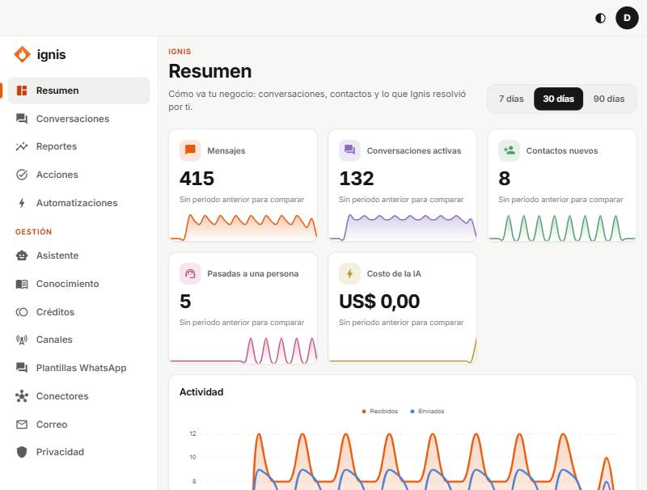

# Resumen

«Cómo va tu negocio: conversaciones, contactos y lo que Ignis resolvió por ti.»

## Periodo

Arriba eliges **7 días**, **30 días** o **90 días**. Todas las cifras y gráficas se ajustan.

## Las cifras

| Cifra                      | Qué es                                                                 |
| -------------------------- | ---------------------------------------------------------------------- |
| **Mensajes**               | Mensajes recibidos y enviados en el periodo.                           |
| **Conversaciones activas** | Conversaciones con actividad.                                          |
| **Contactos nuevos**       | Personas que te escribieron por primera vez.                           |
| **Pasadas a una persona**  | Veces que el asistente le pasó la conversación a alguien de tu equipo. |
| **Costo de la IA**         | Lo que se descontó de tu crédito por usar IA.                          |

## Las gráficas

- **Actividad:** mensajes **Recibidos** y **Enviados** y **Conversaciones activas**, día a día.
- **Se resolvieron solas:** qué parte de las conversaciones no necesitó a una persona.
- **Por qué se pasó a una persona:** **Lo pidió el contacto**, **Lo decidió el asistente** o **El asistente no pudo resolverlo**. Si no hubo traspasos verás «Ninguna conversación se pasó a una persona en este periodo.».

Si tu rol es **Visor** verás una nota: solo ves conversaciones y estadísticas si un administrador te da más permisos.
