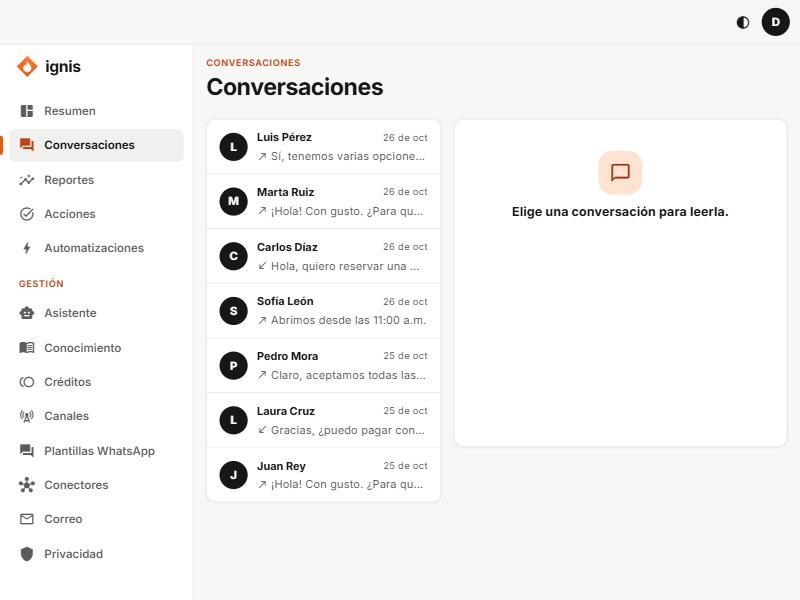

# Conversaciones

Aquí lees lo que el asistente habla con tus contactos y, cuando haga falta, atiendes tú.

## Cómo se usa

1. A la izquierda, la lista de contactos. Elige uno («Elige una conversación para leerla.»).
2. A la derecha, los mensajes. Los del contacto dicen **Contacto** y los del asistente **Asistente**. **Mensajes anteriores** carga los más viejos.
3. Cuando el asistente usó tus documentos, verás debajo de su respuesta las **Fuentes**.

## Marcas en los mensajes

| Marca                     | Significa                                                                               |
| ------------------------- | --------------------------------------------------------------------------------------- |
| **No llegó al asistente** | El mensaje se detuvo antes (por ejemplo, el contacto no aceptó el aviso de privacidad). |
| **No se pudo enviar**     | La respuesta no salió por el canal.                                                     |
| **Cerrada**               | La conversación terminó.                                                                |
| **Sin nombre**            | El canal no entregó el nombre del contacto.                                             |

## Cuando atiende una persona

Si la conversación se pasó a una persona verás **Atiende una persona**: el asistente guarda silencio y muestra cuándo **vuelve sola al asistente**. Con **Devolver al asistente** se la devuelves tú antes («La conversación volvió al asistente.»).
