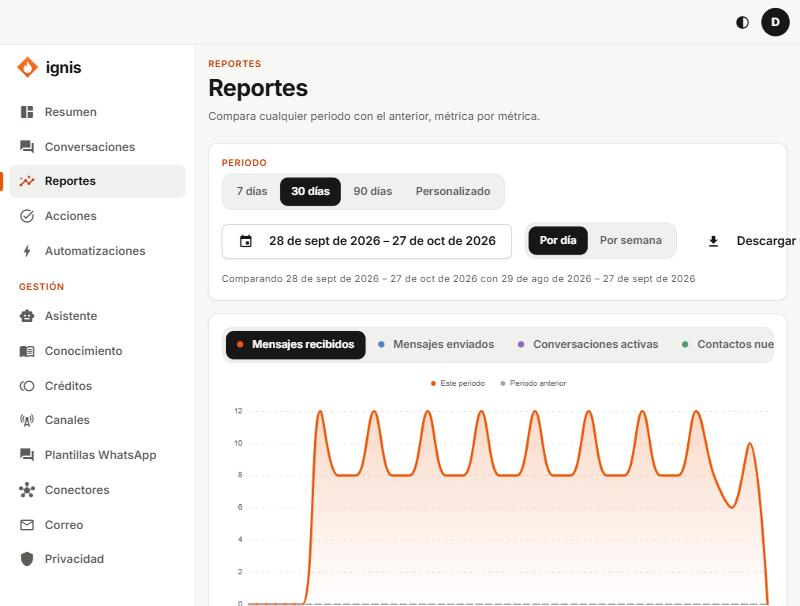

# Reportes

«Compara cualquier periodo con el anterior, métrica por métrica.»

## Opciones

| Opción                   | Qué hace                                                                                                     |
| ------------------------ | ------------------------------------------------------------------------------------------------------------ |
| **Periodo**              | Atajos de días o **Personalizado** (desde/hasta; máximo 366 días: «El periodo puede tener hasta 366 días.»). |
| **Métrica**              | Qué medir (ver abajo).                                                                                       |
| **Por día / Por semana** | Cómo agrupar la gráfica.                                                                                     |

La gráfica compara **Este periodo** con el **Periodo anterior** del mismo largo («Comparando … con …»).

## Métricas

**Mensajes recibidos**, **Mensajes enviados**, **Conversaciones activas**, **Contactos nuevos**, **Pasadas a una persona**, **Llamadas a la IA** y **Costo de la IA**.

## Resumen del periodo

Una tabla con cada métrica, su valor, el del periodo anterior y el **Cambio**.
