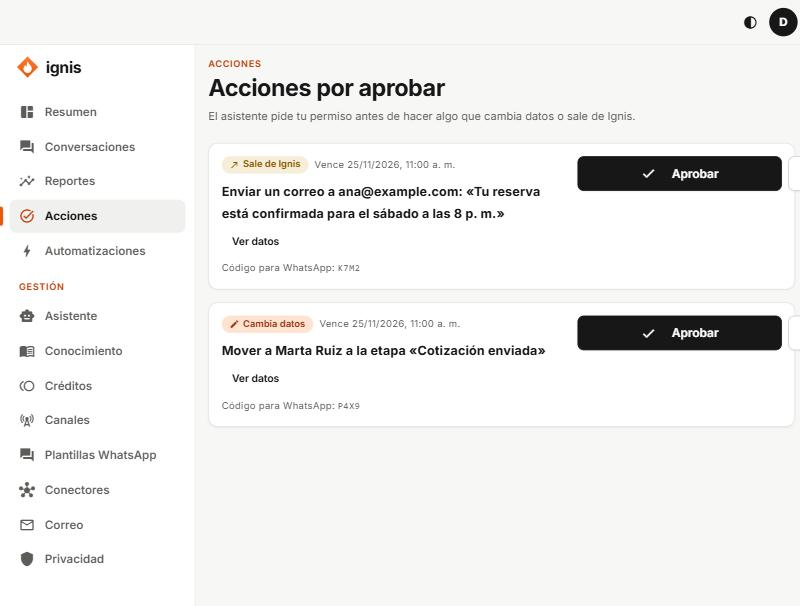

# Acciones por aprobar

«El asistente pide tu permiso antes de hacer algo que cambia datos o sale de Ignis.»

Cuando el asistente quiere, por ejemplo, crear un contacto en tu CRM, te lo pide aquí en vez de hacerlo solo.

| Elemento                             | Qué es                                                   |
| ------------------------------------ | -------------------------------------------------------- |
| **Cambia datos** / **Sale de Ignis** | El tipo de riesgo de la acción.                          |
| **Ver datos**                        | Lo que va a enviar el asistente. Léelo antes de decidir. |
| **Vence**                            | Hasta cuándo puedes responder.                           |
| **Código para WhatsApp**             | Para aprobar contestando por WhatsApp.                   |
| **Aprobar** / **Rechazar**           | Tu decisión.                                             |

Mensajes: «Acción aprobada.», «Acción rechazada.», «La acción se aprobó pero no se pudo completar.», «Alguien ya respondió esta acción.». Sin pendientes verás «No hay acciones esperando tu respuesta.».
