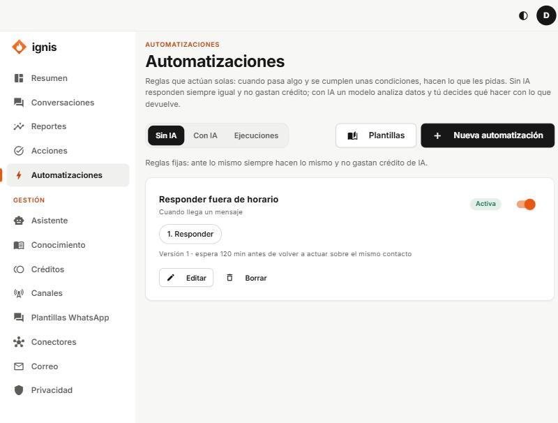
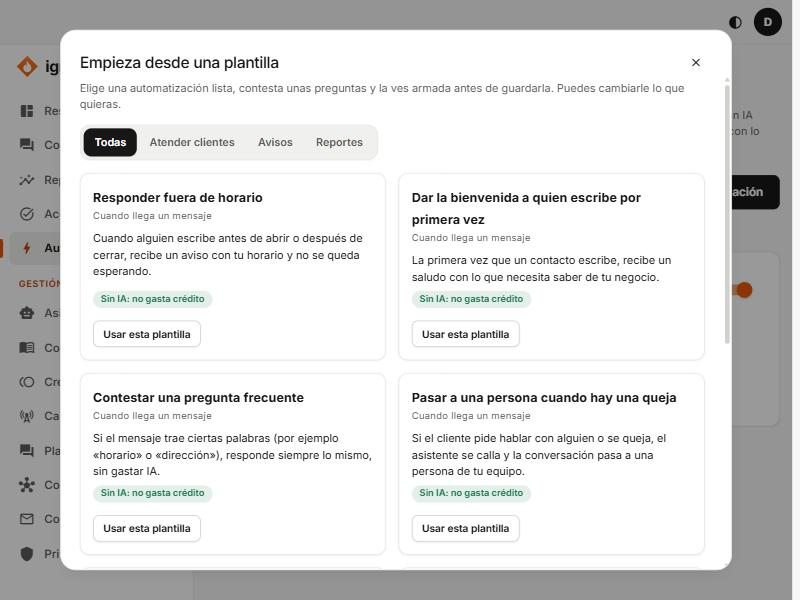
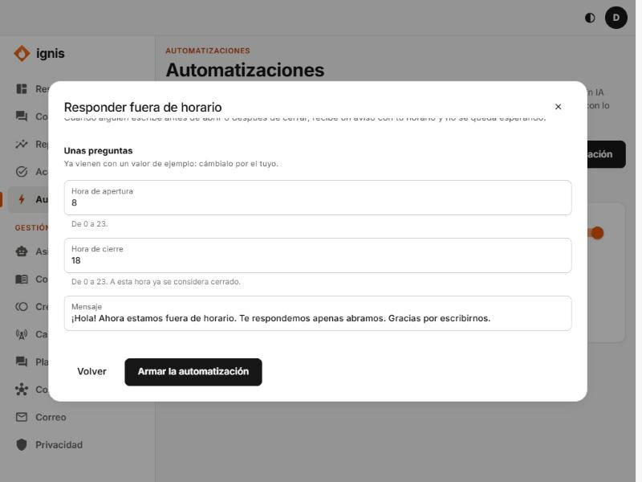

# Automatizaciones

Reglas que actúan solas: **cuando** pasa algo, **y si** se cumplen unas condiciones, **entonces** hacen lo que les pidas. Sin IA responden siempre igual y no gastan crédito; con IA un modelo analiza datos y tú decides qué hacer con lo que devuelve.



La pantalla tiene tres pestañas: **Sin IA**, **Con IA** y **Ejecuciones** (lo que hizo cada regla, 30 días). Cada tarjeta tiene un interruptor **Activa/Apagada**, **Editar** y **Borrar**.

> La referencia completa de cada opción (condiciones, todos los pasos, opciones y la bitácora) está en [la guía del equipo](../equipo/10-pestana-automatizaciones.md), que describe exactamente la misma pantalla. Aquí tienes lo esencial y dos tutoriales.

## Lo esencial

- **Cuándo:** _Cuando llega un mensaje_ o _A una hora fija_.
- **Solo si…:** condiciones sobre el texto, el canal, el nombre, si es contacto nuevo, el día o la hora.
- **Qué hace:** hasta 10 pasos: **Responder**, **Avisar por correo**, **Llamar a un sistema**, **Pasar a una persona**, **Leer la actividad**, **Consultar conocimiento**, **Escribir por WhatsApp con una plantilla**, **Esperar** y los de IA (**Analizar con IA**, **Extraer datos con IA**).
- **Opciones:** espera entre ejecuciones, zona horaria y tope de gasto de IA.
- **Probar antes de guardar:** simula un mensaje y te dice qué haría la regla; **no envía nada ni gasta IA**.

## Empezar desde una plantilla



1. Pulsa **Plantillas** y elige una (por ejemplo **Responder fuera de horario**) → **Usar esta plantilla**.
2. Contesta **Unas preguntas** (traen un valor de ejemplo; cámbialo por el tuyo).

   

3. **Armar la automatización**, revísala, pruébala y **Guardar automatización**.

## Tutorial: avisarme de una queja y pasarla a una persona

1. **Nueva automatización**. **Nombre:** `Queja: avisar y pasar a una persona`.
2. **Cuándo:** _Cuando llega un mensaje_.
3. **Solo si…** → **Texto del mensaje** · **contiene alguna de** · `queja, reclamo, molesto, mal servicio`.
4. **Responder:** `Entiendo, {{contact.name}}. Ya le aviso a una persona de nuestro equipo para que te atienda.`
5. Agrega **Pasar a una persona** (nota: `El cliente presentó una queja`).
6. Agrega **Avisar por correo**: asunto `Queja de {{contact.name}}`, mensaje `{{contact.name}} escribió por {{message.channel}}: {{message.text}}`.
7. **Opciones:** espera entre ejecuciones `60`.
8. **Probar antes de guardar** con `tengo una queja del pedido` → «La regla actuaría». Con `hola` → «no actuaría».
9. **Guardar automatización.**

## Tutorial: resumen diario por correo

1. **Nueva automatización** · **Nombre:** `Resumen diario` · **Cuándo:** _A una hora fija_ · `07:00` · `America/Bogota`.
2. Quita el paso **Responder** y agrega **Leer la actividad** (últimos 1 días, guardar como `stats`).
3. Agrega **Avisar por correo** con asunto `Resumen de ayer ({{vars.stats.from}})` y el mensaje:

   ```
   Mensajes recibidos: {{vars.stats.messages_in}}
   Mensajes enviados: {{vars.stats.messages_out}}
   Contactos nuevos: {{vars.stats.new_contacts}}
   Pasadas a una persona: {{vars.stats.handoffs}}
   ```

4. **Guardar.** Mañana a las 7:00 llegará el correo.

## Si algo falla

- «Tu plan no incluye las automatizaciones»: pídele al equipo de Ignis que active el módulo.
- Una ejecución **Falló**: ábrela, mira qué paso falló y por qué, corrige y pulsa **Reintentar** (retoma desde el paso que falló).
- El correo necesita que [Correo](12-correo.md) tenga direcciones.
