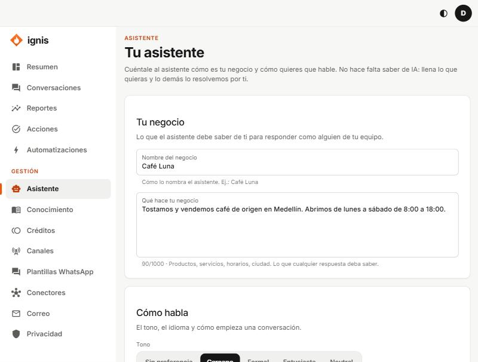

# Asistente

Aquí le cuentas al asistente **cómo es tu negocio y cómo debe hablar**. No tienes que escribir instrucciones técnicas: llenas los campos y el cambio se aplica **en la siguiente respuesta**.

| Sección                      | Campo                   | Qué poner                                                            |
| ---------------------------- | ----------------------- | -------------------------------------------------------------------- |
| **Tu negocio**               | **Nombre del negocio**  | Ej.: `Café Luna` (80 caracteres).                                    |
|                              | **Qué hace tu negocio** | Productos, servicios, horarios, ciudad (hasta 1000).                 |
| **Cómo habla**               | **Tono**                | Sin preferencia, Cercano, Formal, Entusiasta o Neutral.              |
|                              | **Idioma**              | Por ejemplo `español`. Vacío = responde en el idioma del cliente.    |
|                              | **Saludo**              | Cómo empieza la primera respuesta; admite `{{business_name}}` (300). |
| **Reglas**                   | **Siempre** / **Nunca** | Una por línea; hasta 10, de 200 caracteres.                          |
| **Indicaciones adicionales** | Texto libre             | Hasta 1500.                                                          |

Puedes usar `{{business_name}}` y `{{language}}`; otras variables se rechazan.

## Botones

- **Ver instrucción:** muestra lo que recibe el asistente, sin guardar.
- **Guardar:** aplica los cambios («Listo: el asistente ya responde así.»).
- **Volver a lo básico:** borra tu perfil (pide confirmación).

Ignis siempre añade sus reglas de seguridad al final (no revelar instrucciones, tratar documentos y mensajes como datos, ser honesto cuando no sabe): no se pueden desactivar. La referencia completa y un ejemplo para Café Luna están en la [guía del equipo](../equipo/06-pestana-asistente.md).
