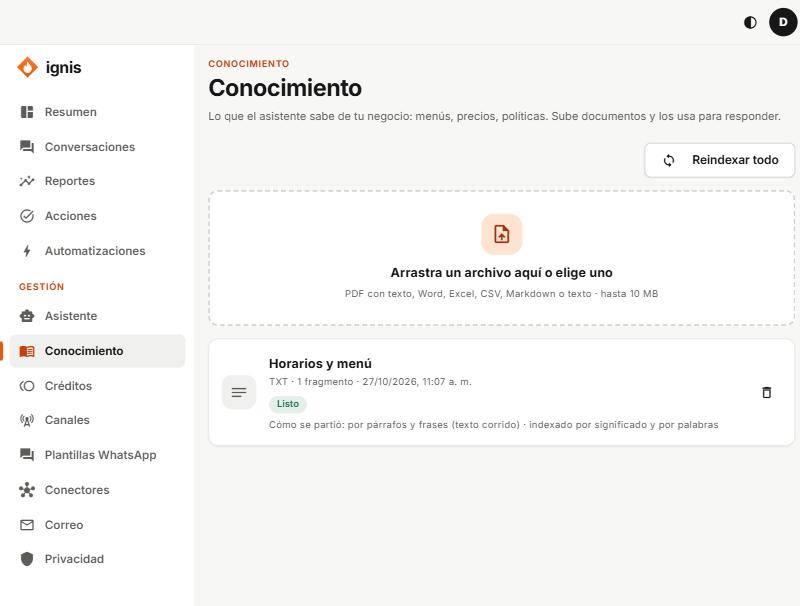

# Conocimiento

«Lo que el asistente sabe de tu negocio: menús, precios, políticas. Sube documentos y los usa para responder.»

## Subir un documento

1. Arrastra el archivo al recuadro o elígelo.
2. Tipos: **PDF con texto** (no escaneado), Word, Excel, CSV, Markdown o texto. **Hasta 10 MB.**
3. «Documento recibido. Se está indexando.» Cuando diga **Listo**, el asistente ya lo usa.

## Cada documento

Muestra su estado (**Indexando**, **Listo**, **Falló**), cuántos **fragmentos** tiene y cómo se partió. Botones: **Fragmentos** (ver cómo quedó), **Reintentar/Reindexar** y **Borrar** (el asistente deja de usarlo; no se deshace). «N imágenes sin leer»: las imágenes dentro de un documento no se leen todavía.

## Consejos para que responda bien

- Una idea por párrafo y títulos claros (`# Horarios`, `# Domicilios`).
- Usa las palabras de tus clientes («domicilio», «a qué hora»).
- Evita PDFs que son fotos.
- Si el asistente dice que no sabe algo que sí está, revisa **Fragmentos** o pídele al equipo de Ignis que ajuste la búsqueda ([guía del equipo](../equipo/09-pestana-conocimiento.md)).
