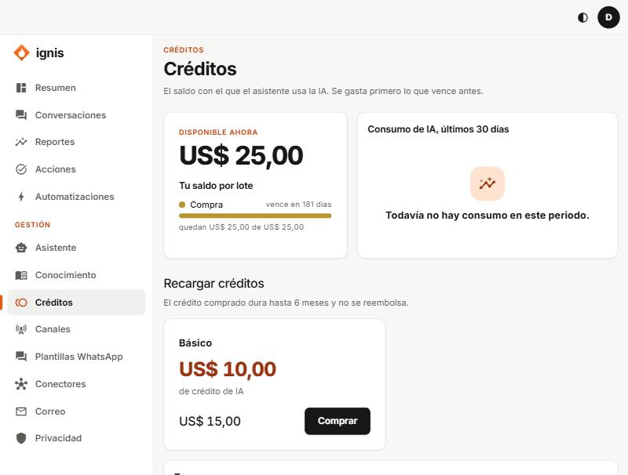

# Créditos

«El saldo con el que el asistente usa la IA. Se gasta primero lo que vence antes.»

| Bloque                             | Qué muestra                                                                                   |
| ---------------------------------- | --------------------------------------------------------------------------------------------- |
| **Disponible ahora**               | Tu saldo. Avisa si parte **vence pronto**.                                                    |
| **Tu saldo por lote**              | Cada lote (**Plan del periodo**, **Compra**, **Cortesía**), cuánto queda y cuándo vence.      |
| **Consumo de IA, últimos 30 días** | Cuánto se gastó.                                                                              |
| **Recargar créditos**              | Los paquetes a la venta. El crédito comprado dura hasta 6 meses y no se reembolsa.            |
| **Tus compras**                    | Tus órdenes: **Pendiente**, **Pagada**, **Fallida**.                                          |
| **Movimientos**                    | Ingresos, reservas, consumos y reservas liberadas. «estimado» marca cifras aún no liquidadas. |

## Recargar

1. En un paquete pulsa **Comprar**.
2. Confirma (nombre, crédito y precio) con **Ir a pagar**: pasas a la página de pago.
3. Cuando se confirme, la orden pasa a **Pagada** y el saldo sube.

Si ves «Los pagos aún no están disponibles. Escríbenos y te ayudamos.», el cobro en línea no está activado todavía: contacta al equipo de Ignis. Sin crédito, el asistente no puede responder con IA.

## Tu plan

Arriba verás tu **plan**, su precio mensual y el **crédito de IA que incluye cada mes**. Ese crédito vence al final del mes y no se acumula; el que compras aparte dura hasta 6 meses y se gasta después del del plan.
