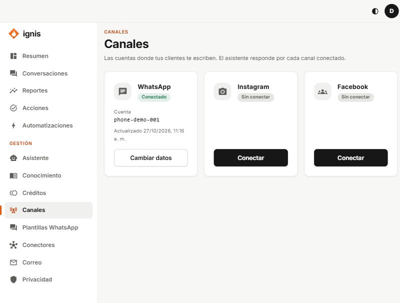
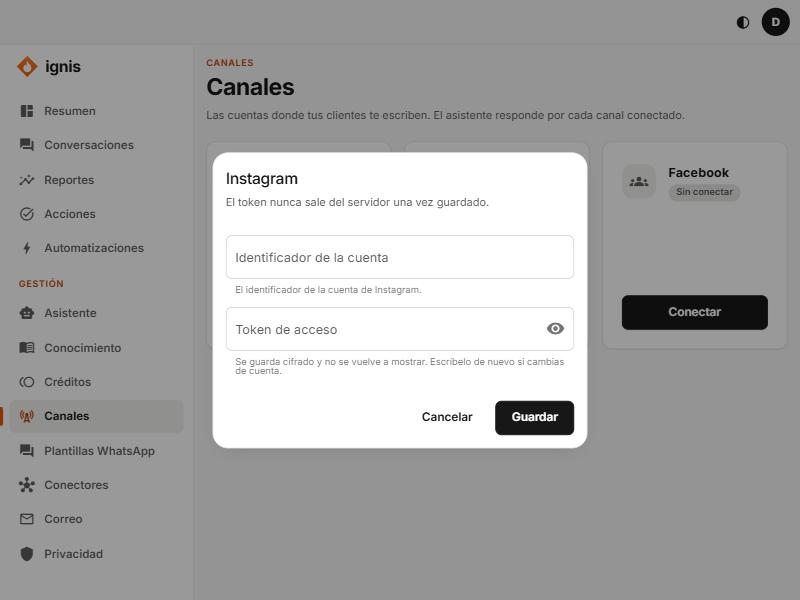

# Canales

«Las cuentas donde tus clientes te escriben. El asistente responde por cada canal conectado.»

Hay tres: **WhatsApp**, **Instagram** y **Facebook**. Cada uno está **Conectado**, **Sin conectar** o **Desactivado**. Si dice «Este canal no está incluido en tu plan», pídelo al equipo de Ignis.

## Conectar un canal

1. Pulsa **Conectar** (o **Cambiar datos** si ya está conectado).
2. **Identificador de la cuenta:** en WhatsApp es el identificador del número (`phone_number_id`); en Instagram, el de la cuenta; en Facebook, el de la página.
3. **Token de acceso:** el que entrega Meta. Se guarda **cifrado** y no se vuelve a mostrar; escríbelo de nuevo si cambias de cuenta.
4. **Guardar:** «Canal guardado.».

Si Meta rechaza el token, probablemente venció: genera uno permanente y vuelve a pegarlo. El paso a paso completo con Meta está en [Conectar WhatsApp](../equipo/13-conectar-whatsapp.md).
