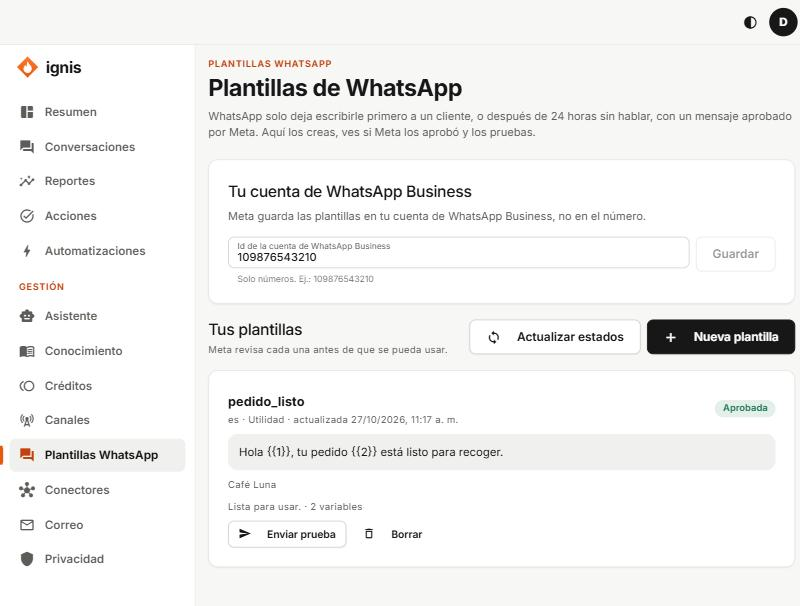

# Plantillas de WhatsApp

WhatsApp solo te deja escribirle **libremente** a un cliente durante las **24 horas** siguientes a su último mensaje. Para escribirle primero o pasado ese tiempo necesitas una **plantilla**: un mensaje que **Meta revisa y aprueba**.

Requisitos: canal de WhatsApp conectado en [Canales](09-canales.md) y la **cuenta de WhatsApp Business** de Meta.

## Tu cuenta de WhatsApp Business

Escribe el **Id de la cuenta de WhatsApp Business** (solo dígitos; en Meta Business Suite → Configuración → Cuentas → Cuentas de WhatsApp) y **Guardar** («Cuenta guardada.»).

## Estados

**En revisión** (minutos a un día) · **Aprobada** (lista) · **Rechazada** (se muestra el «Motivo de Meta») · **Pausada** · **Desactivada**. **Actualizar estados** pregunta a Meta.

## Tutorial: crear la plantilla «Pedido listo»

1. **Nueva plantilla**.
2. **Cómo la llamas:** `Pedido listo` (el **Nombre para Meta** se arma solo: `pedido_listo`).
3. **Idioma:** `es`. **Tipo:** **Utilidad** (aviso de algo que el cliente ya hizo; **Marketing** es para promociones).
4. **Mensaje:** `Hola {{1}}, tu pedido {{2}} ya está listo para recoger en Café Luna.`
5. **Ejemplos de los datos:** `Ana` y `1042`.
6. **Pie (opcional):** `Café Luna`.
7. **Enviar a Meta.** Queda **En revisión**; pulsa **Actualizar estados** hasta que diga **Aprobada**.
8. **Enviar prueba:** tu número con código de país (`573001234567`), un valor por variable y **Enviar**.

Reglas de Meta: variables en orden (`{{1}}`, `{{2}}`…), nunca juntas, y el mensaje no puede empezar ni terminar con una variable. Máximo 1024 caracteres.

## Usarla

En [Automatizaciones](05-automatizaciones.md), el paso **Escribir por WhatsApp con una plantilla** envía una plantilla aprobada. Ver el [tutorial de seguimiento](../equipo/10-pestana-automatizaciones.md#tutorial-e-seguimiento-24-horas-después-con-una-plantilla-de-whatsapp).

**Borrar** también la borra en Meta (todos sus idiomas) y no se deshace. Referencia completa: [guía del equipo](../equipo/07-pestana-plantillas-whatsapp.md).
