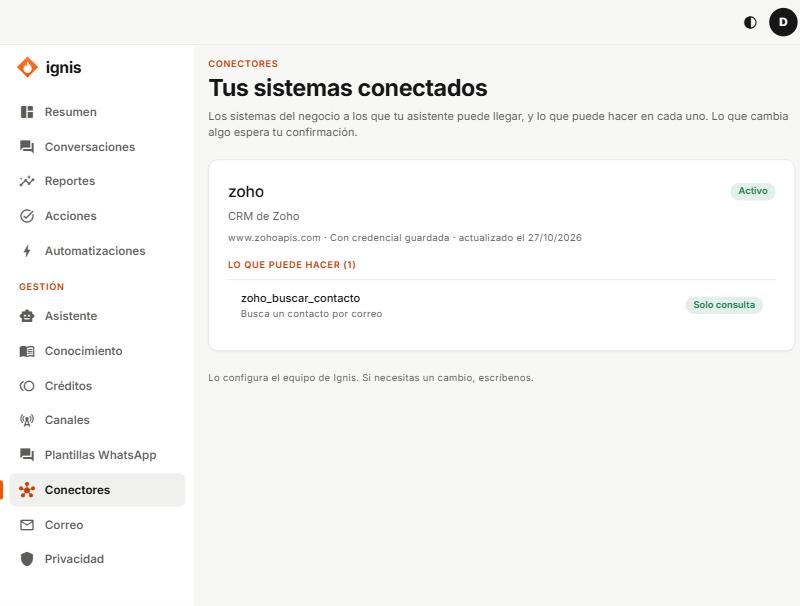

# Conectores

«Los sistemas del negocio a los que tu asistente puede llegar, y lo que puede hacer en cada uno. Lo que cambia algo espera tu confirmación.»

Esta pantalla es de **solo lectura**: el equipo de Ignis conecta tus sistemas (agenda, CRM…).

Por cada sistema ves si está **Activo** o **Apagado**, si tiene **credencial guardada** y **Lo que puede hacer**, con su riesgo:

- **Solo consulta:** lee datos; se hace sin preguntar.
- **Pide tu confirmación:** cambia algo o sale de Ignis; aparecerá en [Acciones](04-acciones.md) para que lo apruebes.

Si no hay ninguno, «Cuando conectemos tu agenda, tu CRM u otro sistema, aparecerá aquí.».
