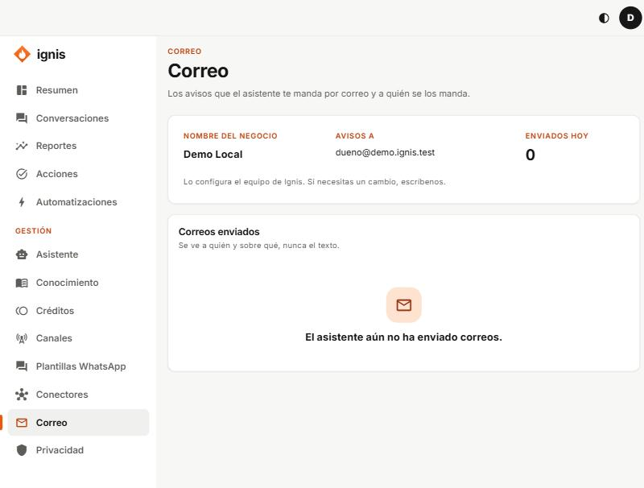

# Correo

«Los avisos que el asistente te manda por correo y a quién se los manda.»

Es de **solo lectura**: el equipo de Ignis configura el nombre y las direcciones.

- **Nombre del negocio:** el remitente de los correos.
- **Avisos a:** las direcciones que los reciben (hasta 5).
- **Enviados hoy:** cuántos se han mandado hoy (hay un tope diario).
- **Correos enviados:** a quién y sobre qué, nunca el texto. Estados: **En cola**, **Enviado**, **Falló**; tipos: **A tu negocio** o **A un contacto**.

Si dice «Aún no está configurado: el asistente no enviará correos hasta que lo configuremos», escríbele al equipo de Ignis con las direcciones que quieres.
