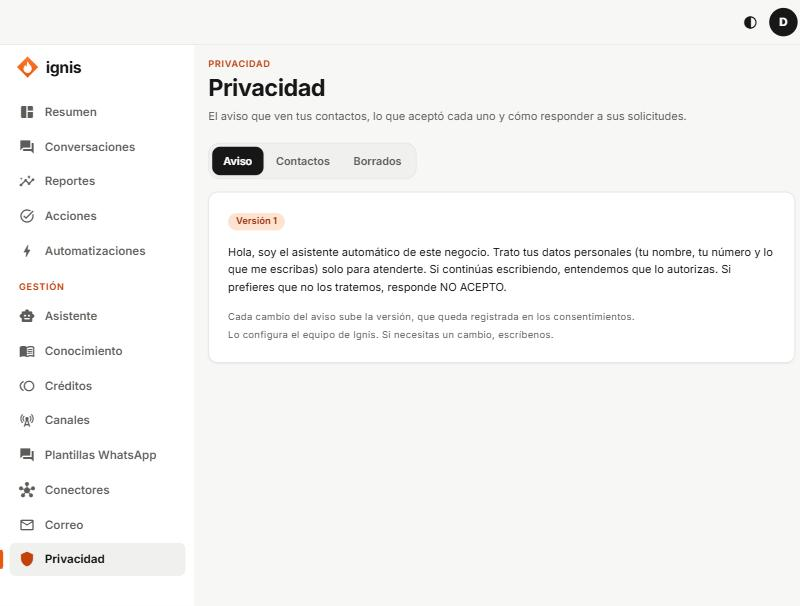

# Privacidad

«El aviso que ven tus contactos, lo que aceptó cada uno y cómo responder a sus solicitudes.»

Tiene tres pestañas.

## Aviso

El texto que se muestra a quien escribe por primera vez, con su **Versión**. Cada cambio sube la versión y queda registrada en los consentimientos.

## Contactos

Cada contacto con lo que aceptó:

- **Estados:** **Avisado**, **Aceptó**, **Revocó**. Si sigue escribiendo, cuenta como que aceptó («Siguió la conversación»); si responde «NO ACEPTO» queda como **Revocó**.
- **Propósitos:** **Tratamiento de datos** y **Correo** (los correos a un contacto exigen un sí explícito).
- **Registrar consentimiento:** si lo recogiste por tu cuenta, indica el correo y **cómo y cuándo se obtuvo**.
- **Exportar datos:** descarga todo lo que Ignis tiene del contacto (si te lo pide).
- **Borrar contacto:** escribe «borrar» para confirmar. Se borran el contacto, conversaciones, mensajes, traspasos y correos; queda solo la prueba de consentimiento sin nombre, número ni correo. No se deshace.

## Borrados

La lista de pruebas de consentimiento que se conservan tras un borrado (**A pedido del titular** o **Por retención**). No contienen datos personales.

El texto del aviso lo configura el equipo de Ignis ([guía](../equipo/11-pestana-privacidad.md)); conviene que un abogado lo revise.
