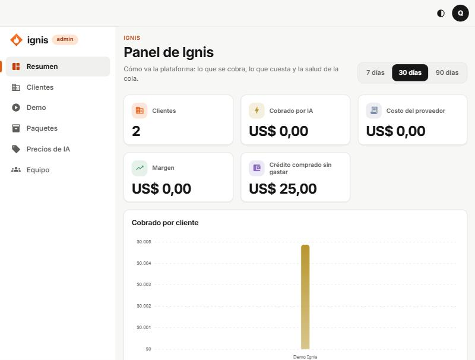

# 0. Primeros pasos: entrar y moverse por el panel

## Para qué sirve el panel de Ignis

Es la consola del equipo que opera la plataforma. Desde aquí se da de alta a los clientes, se les activan módulos, se conectan sus sistemas, se les suben documentos, se arman sus automatizaciones y se vigila lo que cuesta la IA. **Un cliente nunca ve este panel**: tiene el suyo, más sencillo (serie «Cliente»).

## Entrar

1. Abre la dirección de la consola y entra por **Acceso del equipo de Ignis** (al final de la pantalla de ingreso de los clientes), o directamente en `/admin/login`.
2. Escribe tu **Correo electrónico** y tu **Contraseña** y pulsa **Ingresar**.
3. Escribe el código de 6 dígitos de tu app de autenticación (Google Authenticator, Authy, etc.) y pulsa **Continuar**.
   - La primera vez, la consola te muestra un código QR para registrar la app y unos **códigos de recuperación**: guárdalos en un lugar seguro. Cada uno sirve una sola vez.
   - Si perdiste el teléfono, usa **Usar un código de recuperación**, o pídele a un super admin que te quite el segundo factor (ver [Equipo](12-apartados-generales.md#equipo)).
4. Llegas al **Resumen**.

> El segundo factor es obligatorio para todo el equipo. Después de varios intentos fallidos la cuenta se bloquea un rato.

## El mapa del panel

El menú de la izquierda (en el celular, la barra de abajo y **Más**) tiene seis apartados:

| Apartado          | Para qué sirve                                                                                             |
| ----------------- | ---------------------------------------------------------------------------------------------------------- |
| **Resumen**       | Cómo va la plataforma: cuánto se cobra por IA, cuánto cuesta, el margen y la salud de la cola de trabajos. |
| **Clientes**      | La lista de negocios. Aquí se crea un cliente y se entra a configurarlo (pestañas).                        |
| **Demo**          | Una conversación de muestra con IA real para enseñarle Ignis a un prospecto.                               |
| **Paquetes**      | Los paquetes de crédito que los clientes pueden comprar.                                                   |
| **Precios de IA** | Lo que cuesta cada modelo de IA por millón de tokens; con esto se cobra a todos.                           |
| **Equipo**        | Las personas del equipo de Ignis (solo lo ve un super admin).                                              |

Arriba a la derecha:

- El botón con medio círculo cambia entre **tema claro y oscuro**.
- El círculo con tu inicial abre tu menú: ahí está **Cerrar sesión**.

## Roles del equipo

- **Super admin:** puede todo, incluida la sección **Equipo** (invitar, desactivar, quitar el segundo factor).
- **Equipo:** opera clientes y plataforma, pero no gestiona personas.

## Siguiente paso

[Crear un cliente →](01-crear-un-cliente.md)
