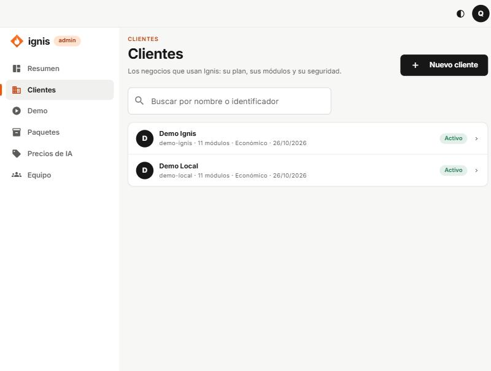
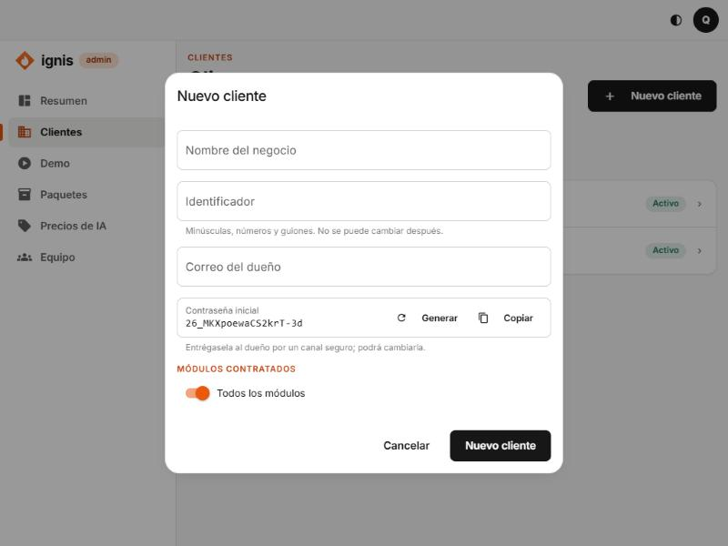

# 1. Crear un cliente

## Para qué sirve

Cada negocio que usa Ignis es un **cliente** (en el código, un _tenant_). Al crearlo se prepara un espacio aislado con su dueño, sus módulos contratados y su propio plan. Todo lo demás (canales, conocimiento, automatizaciones) se configura después, pestaña por pestaña.

## La lista de clientes

- **Buscar por nombre o identificador:** filtra la lista mientras escribes.
- Cada fila muestra el nombre, el identificador (`demo-local`), cuántos **módulos** tiene, su perfil de IA (**Económico** o **Calidad**), la fecha de alta y su estado (**Activo** o **Suspendido**).
- Al pulsar una fila entras a las pestañas del cliente.
- **Ver más clientes** carga más cuando hay muchos.

## Tutorial: dar de alta a «Café Luna»

1. En **Clientes**, pulsa **Nuevo cliente**.

   

2. Llena el formulario:

   | Campo                   | Qué poner                                                                                                        | Ejemplo                |
   | ----------------------- | ---------------------------------------------------------------------------------------------------------------- | ---------------------- |
   | **Nombre del negocio**  | El nombre comercial, como lo verán en el panel.                                                                  | `Café Luna`            |
   | **Identificador**       | Una palabra corta en minúsculas, números y guiones. **No se puede cambiar después.** Debe ser único.             | `cafe-luna`            |
   | **Correo del dueño**    | Con este correo entrará el dueño. Debe ser único en toda la plataforma.                                          | `dueno@cafeluna.co`    |
   | **Contraseña inicial**  | Mínimo 12 caracteres. Pulsa **Generar** para crear una segura y **Copiar** para llevártela.                      | (generada)             |
   | **Módulos contratados** | Qué capacidades tendrá. Con **Todos los módulos** encendido se contratan todas; apágalo para elegir una por una. | Todos (para el piloto) |

3. Pulsa **Nuevo cliente** (el botón del final). Verás «Cliente creado.».
4. **Entrégale la contraseña al dueño por un canal seguro** (nunca por el mismo chat donde se la escribes a otros). Podrá cambiarla.
5. La primera vez que el dueño entre, la consola le pedirá configurar su segundo factor si tú lo exiges (ver [Seguridad](03-pestana-seguridad.md)).

### Errores frecuentes

- «Ya existe un cliente con ese identificador o ese correo.»: cambia el identificador o usa otro correo.
- «Revisa los datos: la contraseña necesita 12 caracteres o más.»
- «El identificador no es válido.»: usa solo minúsculas, números y guiones.

## Después de crear el cliente

Entra a su ficha y recorre las pestañas en este orden recomendado:

1. [Plan](02-pestana-plan.md): confirma módulos y límites, y el modelo de IA.
2. [Créditos](04-pestana-creditos.md): acredita saldo (compra o cortesía) para que el asistente pueda responder.
3. [Correo](05-pestana-correo.md): a quién avisar por correo.
4. [Asistente](06-pestana-asistente.md): cómo se presenta (o que lo llene el dueño).
5. [Conocimiento](09-pestana-conocimiento.md): sube sus documentos.
6. [Conectar WhatsApp](13-conectar-whatsapp.md) (el dueño lo hace en **Canales**) y luego [Plantillas WhatsApp](07-pestana-plantillas-whatsapp.md).
7. [Conectores](08-pestana-conectores.md) y [Automatizaciones](10-pestana-automatizaciones.md) si los necesita.
8. [Privacidad](11-pestana-privacidad.md): revisa el aviso que verán sus contactos.

## La ficha de un cliente

Arriba ves el nombre, el identificador y el estado. Debajo, las pestañas: **Plan, Seguridad, Créditos, Correo, Asistente, Plantillas WhatsApp, Conectores, Conocimiento (RAG), Automatizaciones, Privacidad**. Cada una tiene su manual; usa la flecha **← Clientes** para volver a la lista.
