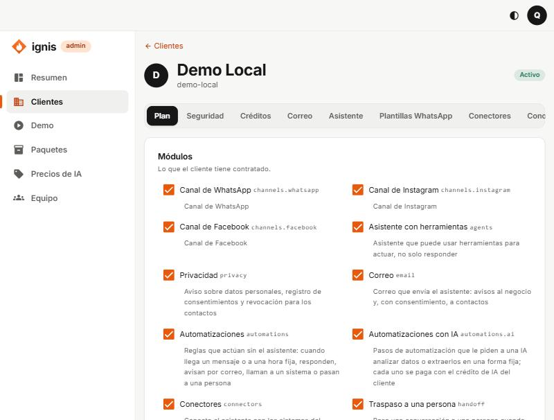
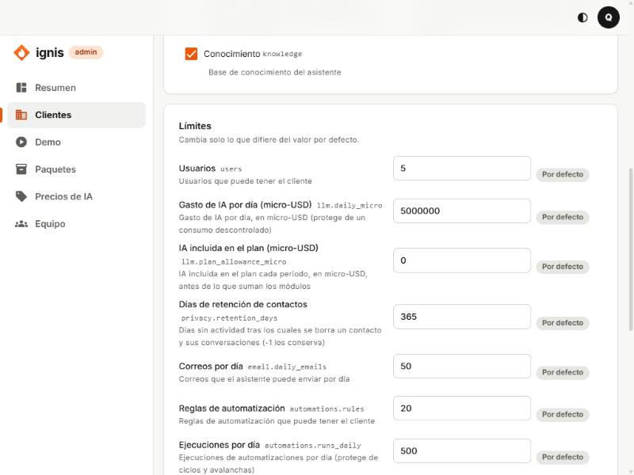
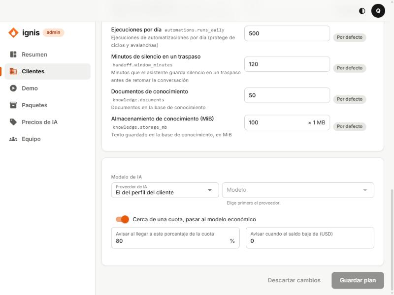

# 2. Pestaña Plan

## Para qué sirve

Define **qué puede hacer** el cliente y **hasta dónde**: qué módulos tiene contratados, qué límites tiene cada uno, qué modelo de IA responde por él y cuándo se le avisa (o se le baja al modelo económico) si se acerca a su cuota de gasto de IA. Todo lo que el cliente ve en su panel depende de esta pestaña: un módulo apagado desaparece de su menú o se rechaza con «Tu plan no incluye…».

## Módulos

Cada módulo es una casilla con su nombre y, al lado en gris, su identificador técnico. Debajo, una línea que dice qué incluye.

| Módulo                         | Identificador        | Qué le da al cliente                                                                                                   |
| ------------------------------ | -------------------- | ---------------------------------------------------------------------------------------------------------------------- |
| **Canal de WhatsApp**          | `channels.whatsapp`  | Conectar su número de WhatsApp en **Canales** y crear plantillas de WhatsApp.                                          |
| **Canal de Instagram**         | `channels.instagram` | Conectar su cuenta de Instagram.                                                                                       |
| **Canal de Facebook**          | `channels.facebook`  | Conectar su página de Facebook.                                                                                        |
| **Asistente con herramientas** | `agents`             | Que el asistente no solo responda, sino que use herramientas (conectores, correo, consultar conocimiento) para actuar. |
| **Privacidad**                 | `privacy`            | El aviso sobre datos personales, el registro de consentimientos y los borrados.                                        |
| **Correo**                     | `email`              | Que el asistente envíe correos: avisos al negocio y, con consentimiento, a contactos.                                  |
| **Automatizaciones**           | `automations`        | Reglas fijas sin IA («cuando llega un mensaje o a una hora, haz esto»).                                                |
| **Automatizaciones con IA**    | `automations.ai`     | Pasos de automatización que le piden a una IA analizar o extraer datos. Cada uno se cobra del crédito del cliente.     |
| **Conectores**                 | `connectors`         | Conectar el asistente a los sistemas del negocio (CRM, reservas…).                                                     |
| **Traspaso a una persona**     | `handoff`            | Pasar una conversación a una persona cuando el contacto lo pide o el asistente no puede ayudar.                        |
| **Conocimiento**               | `knowledge`          | La base de documentos que el asistente consulta.                                                                       |

- Marcar o desmarcar un módulo **no se aplica hasta que guardas**.
- Si quitas un módulo, el cliente deja de ver esa función **de inmediato** al guardar; sus datos no se borran.

## Límites

«Cambia solo lo que difiere del valor por defecto.» Cada fila tiene el nombre del límite, una descripción, un campo con el valor y una etiqueta que dice si es **Por defecto** o **Personalizado**. Los límites de un módulo aparecen solo si el módulo está contratado.

| Límite                                   | Identificador              | Por defecto         | Qué controla                                                                                             |
| ---------------------------------------- | -------------------------- | ------------------- | -------------------------------------------------------------------------------------------------------- |
| **Usuarios**                             | `users`                    | 5                   | Cuántas personas pueden entrar al panel del cliente.                                                     |
| **Gasto de IA por día (micro-USD)**      | `llm.daily_micro`          | 5 000 000 (= US$ 5) | Tope diario de gasto de IA; protege de un consumo descontrolado.                                         |
| **IA incluida en el plan (micro-USD)**   | `llm.plan_allowance_micro` | 0                   | IA que se le regala cada periodo antes de lo que sumen los módulos.                                      |
| **Días de retención de contactos**       | `privacy.retention_days`   | 365                 | Días sin actividad tras los cuales se borra un contacto y sus conversaciones. `-1` los conserva siempre. |
| **Correos por día**                      | `email.daily_emails`       | 50                  | Correos que el asistente puede enviar en un día.                                                         |
| **Reglas de automatización**             | `automations.rules`        | 20                  | Cuántas reglas puede tener.                                                                              |
| **Ejecuciones por día**                  | `automations.runs_daily`   | 500                 | Cuántas veces pueden actuar sus reglas al día (frena ciclos y avalanchas).                               |
| **Minutos de silencio en un traspaso**   | `handoff.window_minutes`   | 120                 | Cuánto guarda silencio el asistente tras pasar la conversación a una persona antes de retomarla.         |
| **Documentos de conocimiento**           | `knowledge.documents`      | 50                  | Cuántos documentos puede tener.                                                                          |
| **Almacenamiento de conocimiento (MiB)** | `knowledge.storage_mb`     | 100                 | Cuánto texto guardado.                                                                                   |

Notas:

- **Micro-USD:** un millón de micro-USD es un dólar. `5000000` = US$ 5.
- **Sin límite:** algunos límites aceptan «Sin límite» (valor `-1`).
- **Usar el valor por defecto:** deja el campo en el valor de la plataforma. Los valores por defecto son provisionales: los define la decisión comercial.

## Modelo de IA y cuotas

| Opción                                             | Qué hace                                                                                                                                                                                                                                                    |
| -------------------------------------------------- | ----------------------------------------------------------------------------------------------------------------------------------------------------------------------------------------------------------------------------------------------------------- |
| **Modelo de IA → Proveedor de IA**                 | Elige el proveedor (Google, Anthropic, DeepSeek, OpenAI). Los que no tienen clave configurada en la plataforma o no tienen precio vigente aparecen deshabilitados con el motivo. «El del perfil del cliente» usa el perfil Económico o Calidad del cliente. |
| **Modelo de IA → Modelo**                          | Elige el modelo de ese proveedor (de la lista de _Precios de IA_). Se habilita al elegir proveedor.                                                                                                                                                         |
| **Cerca de una cuota, pasar al modelo económico**  | Cuando el gasto se acerca al tope, el asistente sigue respondiendo pero con el modelo barato, en vez de cortarse.                                                                                                                                           |
| **Avisar al llegar a este porcentaje de la cuota** | Porcentaje (por ejemplo 80) al que se avisa al cliente de que está cerca del tope.                                                                                                                                                                          |
| **Avisar cuando el saldo baje de (USD)**           | Saldo mínimo en dólares por debajo del cual se avisa que debe recargar. `0` = no avisar.                                                                                                                                                                    |

## Guardar

1. Haz los cambios. Aparece activo **Guardar plan**; **Descartar cambios** vuelve a lo que estaba.
2. Pulsa **Guardar plan**. Si cambiaste módulos, la consola te muestra «¿Aplicar estos cambios?» con lo que **se quita** («El cliente deja de ver esos módulos») y lo que **se agrega**. Confirma.
3. Verás «Plan actualizado.». Los cambios se aplican de inmediato.
4. Si no hay nada que guardar, el botón dice «No hay cambios que guardar.».

## Errores frecuentes

- **El cliente dice «Tu plan no incluye…»:** falta el módulo en esta pestaña.
- **Un proveedor de IA aparece deshabilitado:** «no configurado» = la plataforma no tiene la clave de ese proveedor; «sin precio» = ningún modelo suyo tiene precio vigente en **Precios de IA**.
- **El asistente dejó de responder y el cliente tiene saldo:** revisa el límite **Gasto de IA por día**; si se agotó, no responde hasta mañana o hasta que lo subas.
