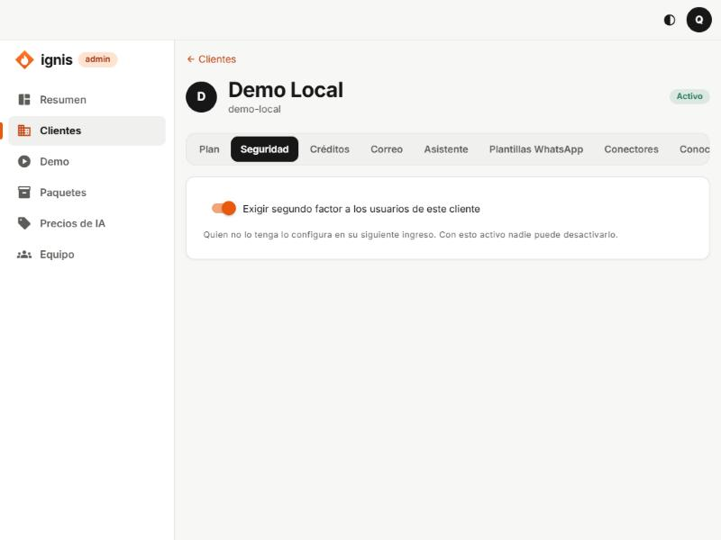

# 3. Pestaña Seguridad

## Para qué sirve

Decide si **todos los usuarios de este cliente** deben proteger su cuenta con un segundo factor (código de 6 dígitos de una app de autenticación), además de la contraseña.

## La opción

**Exigir segundo factor a los usuarios de este cliente** (interruptor)

- **Encendido:** quien no tenga segundo factor configurado lo configura en su **siguiente ingreso**: la consola le muestra un código QR para registrar la app y sus códigos de recuperación. **Con esto activo nadie puede desactivarlo.**
- **Apagado:** cada usuario decide si lo usa.
- Al cambiarlo se guarda al instante: verás «Política actualizada.».

## Cuándo encenderlo

- Siempre que el cliente maneje datos de personas (casi todos): es la medida más barata contra el robo de cuentas.
- Para el piloto, déjalo encendido y avisa al dueño que la primera vez le pedirá escanear un QR.

## Si un usuario del cliente pierde su teléfono

Hoy el restablecimiento del segundo factor de un usuario del cliente se pide al equipo de Ignis (el panel del cliente todavía no tiene una pantalla de usuarios). Consulta [Problemas frecuentes](14-problemas-frecuentes.md).
