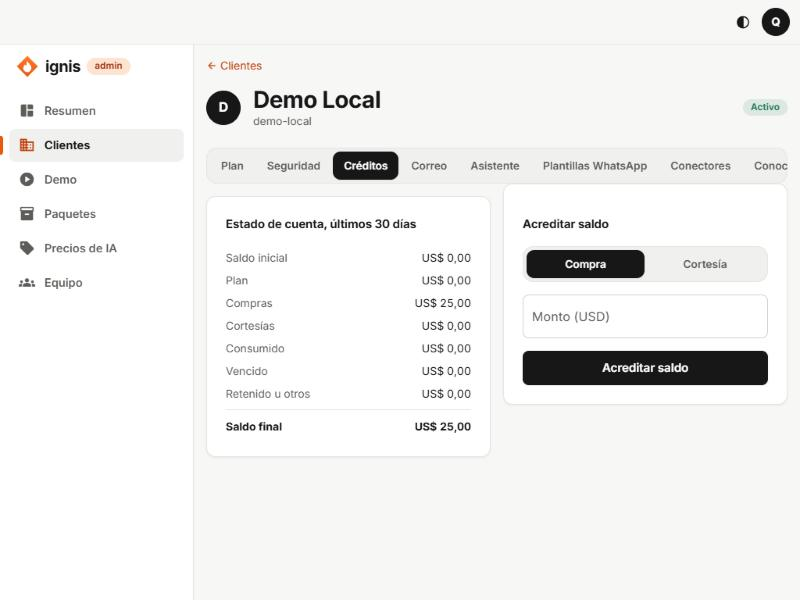

# 4. Pestaña Créditos

## Para qué sirve

El asistente usa IA y la IA cuesta. El **crédito** es el saldo en dólares del cliente con el que se paga cada respuesta. Esta pestaña muestra su **estado de cuenta de los últimos 30 días** y te deja **acreditar saldo** a mano (por una compra que ya recibiste o como cortesía).

## Estado de cuenta, últimos 30 días

Una columna de cifras en dólares que cuadra de arriba abajo:

| Fila                 | Qué es                                    |
| -------------------- | ----------------------------------------- |
| **Saldo inicial**    | Lo que tenía hace 30 días.                |
| **Plan**             | Crédito que le dio su plan en el periodo. |
| **Compras**          | Crédito que compró.                       |
| **Cortesías**        | Crédito que le regalaste.                 |
| **Consumido**        | Lo que gastó el asistente en IA.          |
| **Vencido**          | Crédito que venció sin usarse.            |
| **Retenido u otros** | Reservas en curso y otros ajustes.        |
| **Saldo final**      | Lo que tiene ahora.                       |

## Acreditar saldo

1. En el cuadro **Acreditar saldo**, elige el **Tipo**:
   - **Compra:** el cliente pagó (por fuera de la plataforma, mientras no haya pasarela de pagos). Dura **6 meses como máximo**.
   - **Cortesía:** regalo comercial (por ejemplo, el crédito del piloto). **Exige fecha de vencimiento.**
2. Escribe el **Monto (USD)**: por ejemplo `25` o `12,5`.
3. Si es cortesía, elige **Vence el** (obligatorio).
4. Pulsa **Acreditar saldo**. La consola pregunta «¿Acreditar US$ 25,00 a Café Luna?». Confirma.
5. Verás «Saldo acreditado.» y la tabla se actualiza.

Cada acreditación lleva una **clave única** generada por la consola: si pulsas dos veces por error, **no se acredita dos veces**.

## Errores frecuentes

- «Escribe un monto válido, por ejemplo 25 o 12,5.»
- «Elige cuándo vence la cortesía.»
- **El cliente tiene saldo pero el asistente no responde:** revisa en [Plan](02-pestana-plan.md) el límite **Gasto de IA por día** y en [Precios de IA](12-apartados-generales.md#precios-de-ia) que el modelo tenga precio vigente.

## Para el piloto

Acredita una **Cortesía** de unos US$ 25 con vencimiento a 2 o 3 meses. Es lo que cubre al cliente de pruebas sin necesidad de pasarela de pagos.
