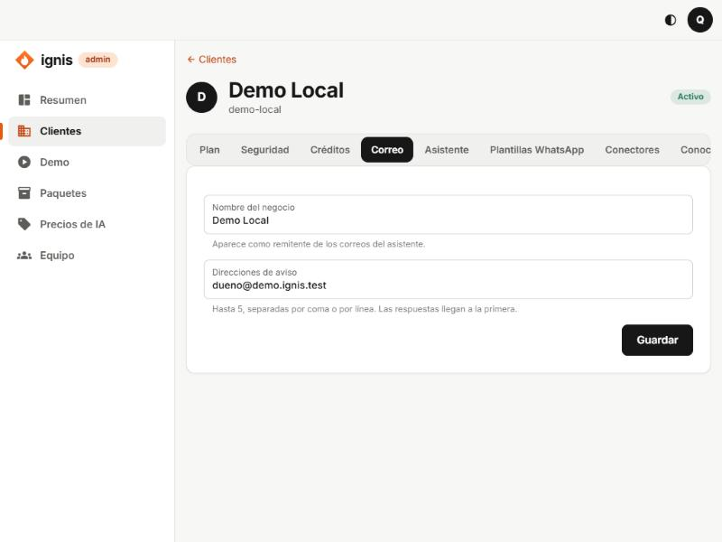

# 5. Pestaña Correo

## Para qué sirve

El asistente (y las automatizaciones) pueden **avisarle al negocio por correo**: una queja, un pedido, un resumen diario. Esta pestaña dice **cómo se llama el negocio en esos correos** y **a quién llegan**. Sin direcciones, el asistente no envía ningún correo de este cliente.

> Para que el correo funcione, el cliente necesita el módulo **Correo** en [Plan](02-pestana-plan.md) y la plataforma debe tener una clave de Brevo configurada (variable `IGNIS_BREVO_API_KEY`). Sin esa clave, el asistente dice que el correo «no está disponible».

## Las opciones

| Campo                    | Qué es                                                                      | Reglas                                                                               |
| ------------------------ | --------------------------------------------------------------------------- | ------------------------------------------------------------------------------------ |
| **Nombre del negocio**   | Aparece como remitente de los correos del asistente.                        | Texto corto.                                                                         |
| **Direcciones de aviso** | Las direcciones que reciben los avisos. Las respuestas llegan a la primera. | **Hasta 5**, separadas por coma o por línea. Cada una debe parecer un correo válido. |

## Paso a paso

1. Escribe el **Nombre del negocio** (por ejemplo `Café Luna`).
2. En **Direcciones de aviso** escribe una o más (`dueno@cafeluna.co`, `ventas@cafeluna.co`).
3. Pulsa **Guardar**. Verás «Correo guardado.».

## Errores frecuentes

- «Hay una dirección que no parece válida: …»: revisa la que indica.
- «Máximo 5 direcciones.»
- «Agrega al menos una dirección.»
- «Hasta que haya direcciones, el asistente no envía ningún correo de este cliente.»: es un aviso normal mientras no configures esta pestaña.

## Qué ve el cliente

En su panel, **Correo** muestra el nombre, a quién se avisa y cuántos correos se enviaron hoy, y una lista de correos enviados (a quién y sobre qué, **nunca el texto**). Es de solo lectura: lo configuras tú aquí.
