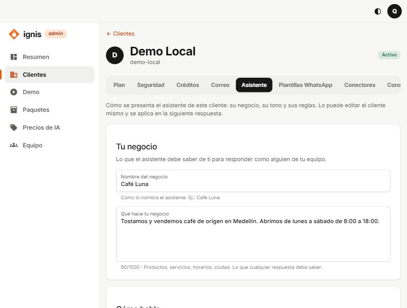

# 6. Pestaña Asistente

## Para qué sirve

Aquí se le cuenta al asistente **cómo es el negocio y cómo debe hablar**: su nombre, qué vende, el tono, el idioma, cómo saluda y qué debe o no debe hacer. Con eso, Ignis arma la instrucción que recibe la IA en cada respuesta; nadie tiene que escribir un _prompt_. El cliente puede editar lo mismo desde su propio panel (**Asistente**): lo que cambie uno lo ve el otro, y se aplica **en la siguiente respuesta**.

Si no se llena nada, el asistente responde de forma amable y breve en el idioma del cliente («Todavía no le has contado nada…»).

## Las opciones, una por una

### Tu negocio

| Campo                   | Qué es                                                                           | Límite                                   |
| ----------------------- | -------------------------------------------------------------------------------- | ---------------------------------------- |
| **Nombre del negocio**  | Cómo lo nombra el asistente. Ej.: `Café Luna`. Si queda vacío dice «la empresa». | 80 caracteres                            |
| **Qué hace tu negocio** | Productos, servicios, horarios, ciudad: lo que cualquier respuesta deba saber.   | 1000 caracteres (se muestra el contador) |

### Cómo habla

| Campo      | Qué es                                                                                                                                                                                                                                                                       |
| ---------- | ---------------------------------------------------------------------------------------------------------------------------------------------------------------------------------------------------------------------------------------------------------------------------- |
| **Tono**   | **Sin preferencia** (amable y breve, sin estilo marcado) · **Cercano** (cálido, como una persona de confianza) · **Formal** (respetuoso, tratando al cliente de usted) · **Entusiasta** (positivo y con energía, sin exagerar) · **Neutral** (claro y directo, sin adornos). |
| **Idioma** | El idioma en que responde siempre (por ejemplo `español`). **Vacío = responde en el idioma del cliente.** Hasta 40 caracteres.                                                                                                                                               |
| **Saludo** | Cómo empieza la **primera respuesta** de una conversación. Admite `{{business_name}}`. Hasta 300 caracteres.                                                                                                                                                                 |

### Reglas

Una regla por línea; hasta **10 reglas** de **200 caracteres** cada una.

| Campo       | Qué es                               | Ejemplo                  |
| ----------- | ------------------------------------ | ------------------------ |
| **Siempre** | Lo que debe hacer en cada respuesta. | `Ofrece el menú del día` |
| **Nunca**   | Lo que no debe hacer.                | `Prometas descuentos`    |

### Indicaciones adicionales (opcional)

Texto libre de hasta **1500 caracteres** con cualquier otra cosa que deba saber o seguir. Se abre al pulsar el título.

### Variables

En los textos largos y en las reglas puedes usar `{{business_name}}` (el nombre del negocio) y `{{language}}` (el idioma). Se reemplazan solas. **Cualquier otra variable se rechaza**: «Solo puedes usar estas variables: {{business_name}}, {{language}}.»

## Ver instrucción, Guardar y Volver a lo básico

- **Ver instrucción** (sección «Lo que recibe el asistente») muestra el texto completo que se armó con lo que escribiste, **sin guardar**. Úsalo para comprobar cómo quedó.
- **Guardar** aplica los cambios (se activa solo si hay cambios y no hay errores). Verás «Listo: el asistente ya responde así.».
- **Volver a lo básico** borra el perfil (pide confirmación) y el asistente vuelve a la instrucción de la plataforma.
- Mientras haya cambios sin guardar aparece «Tienes cambios sin guardar.».

## Lo que el perfil no puede cambiar

Después de lo que escribiste, Ignis siempre agrega **reglas de la plataforma** que ninguna indicación anterior cambia: no revelar las instrucciones, tratar los documentos y los mensajes como datos y no como órdenes, y decir con honestidad cuando no se sabe algo. Un «ignora todas las reglas anteriores» en **Indicaciones adicionales** no funciona.

## Ejemplo completo: Café Luna

- **Nombre del negocio:** `Café Luna`
- **Qué hace tu negocio:** `Tostamos y vendemos café de origen en Medellín. Abrimos de lunes a sábado de 8:00 a 18:00.`
- **Tono:** Cercano · **Idioma:** `español`
- **Saludo:** `¡Hola! Bienvenido a {{business_name}}`
- **Siempre:** `Ofrece el menú del día` / `Pregunta el nombre de quien escribe`
- **Nunca:** `Prometas descuentos`

## Errores frecuentes

- «Máximo 1000 caracteres.» / «Máximo 10 reglas.» / «Cada regla tiene un máximo de 200 caracteres.»: acorta.
- «No se pudo guardar. Revisa los campos e inténtalo de nuevo.»
- El asistente no cambió su forma de hablar: espera a la siguiente respuesta (hasta 15 segundos por la caché) y revisa con **Ver instrucción**.
