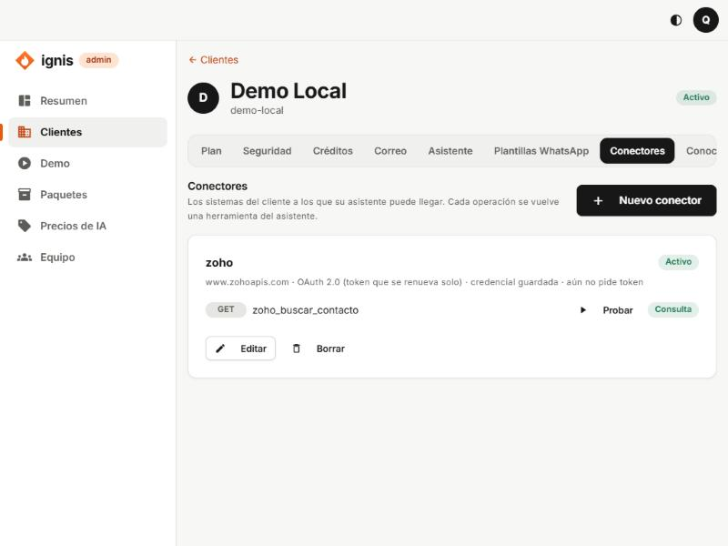
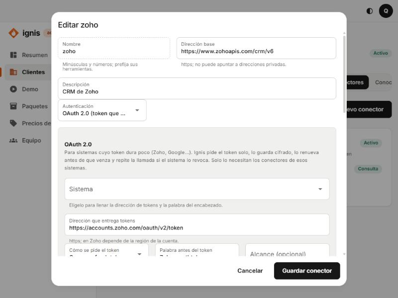
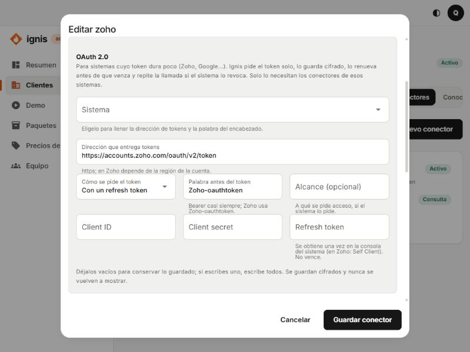

# 8. Pestaña Conectores

## Para qué sirve

Un **conector** une el asistente (y las automatizaciones) con un **sistema del negocio** a través de su API: un CRM como Zoho, un sistema de reservas, una hoja de cálculo con API, un sistema contable. Cada **operación** del conector (por ejemplo «buscar un contacto») se vuelve una **herramienta** que el asistente puede usar, y un paso que una automatización puede llamar. Los conectores los configura **el equipo de Ignis**: el cliente solo ve en su panel la lista de lo que el asistente puede hacer (**Conectores**, de solo lectura).



> Requisito: el cliente debe tener el módulo **Conectores** en [Plan](02-pestana-plan.md).

## La lista

Cada conector muestra su nombre, su estado (**Activo** / **Apagado**), la dirección (`www.zohoapis.com`), el tipo de autenticación, si tiene **credencial guardada** y, si usa OAuth 2.0, hasta cuándo es válido su token. Debajo, sus operaciones con la herramienta que forman (`zoho_buscar_contacto`), su método (GET, POST…) y su riesgo.

- **Nuevo conector:** abre el formulario vacío.
- **Probar** (junto a cada operación): llama a la operación una vez, de verdad (ver más abajo).
- **Editar** y **Borrar** (borrar pide escribir el nombre del conector para confirmar; las herramientas desaparecen del asistente de inmediato).

## El formulario del conector: cada campo

| Campo                                               | Qué es                                                                                   | Reglas                                                                                                                                                        |
| --------------------------------------------------- | ---------------------------------------------------------------------------------------- | ------------------------------------------------------------------------------------------------------------------------------------------------------------- |
| **Nombre**                                          | Identifica al conector y **prefija** sus herramientas (`zoho` → `zoho_buscar_contacto`). | Empieza por letra; minúsculas y números; hasta 24 caracteres. No se cambia al editar.                                                                         |
| **Dirección base**                                  | La URL base del sistema.                                                                 | **https obligatorio**; sin usuario, parámetros ni `#`. **No puede apuntar a direcciones privadas** (red interna, localhost): es una protección contra abusos. |
| **Descripción**                                     | Para qué sirve el sistema; la lee el asistente.                                          | Texto corto.                                                                                                                                                  |
| **Autenticación**                                   | Cómo se identifica Ignis ante el sistema (ver abajo).                                    |                                                                                                                                                               |
| **Activo: el asistente puede usar sus operaciones** | Interruptor. Apagado = el asistente deja de verlo, sin borrarlo.                         |                                                                                                                                                               |
| **Operaciones**                                     | Lo que se puede hacer (ver más abajo).                                                   | Entre 1 y 50.                                                                                                                                                 |

### Autenticación: las cinco opciones

| Opción                                    | Cuándo usarla                                                                                     | Qué pide                                                                                     |
| ----------------------------------------- | ------------------------------------------------------------------------------------------------- | -------------------------------------------------------------------------------------------- |
| **Sin autenticación**                     | APIs públicas.                                                                                    | Nada.                                                                                        |
| **Bearer**                                | La mayoría de APIs modernas con una clave o token fijo: se envía `Authorization: Bearer <token>`. | **Credencial (token).**                                                                      |
| **Cabecera propia**                       | APIs que piden la clave en una cabecera con otro nombre (por ejemplo `X-Api-Key`).                | **Nombre de la cabecera** (no puede ser `Host`, `Content-Type`, `Accept`…) y **Credencial**. |
| **Básica**                                | Usuario y contraseña (`Authorization: Basic …`).                                                  | **Credencial (usuario:contraseña)**.                                                         |
| **OAuth 2.0 (token que se renueva solo)** | Sistemas cuyo token **dura poco** y se renueva con un refresh token: Zoho, Google, Microsoft…     | Ver la sección OAuth 2.0.                                                                    |

La **credencial** se guarda **cifrada** y **nunca se vuelve a mostrar**. Al editar, déjala vacía para conservar la guardada; escribe una nueva solo si cambió. Un conector **nuevo** con autenticación necesita su credencial.

### OAuth 2.0




Ignis pide el token solo, lo guarda cifrado, lo **renueva un minuto antes de que venza** y, si el sistema lo revoca, renueva y repite la llamada una vez.

| Campo                                               | Qué es                                                                                                                                                                                                                           |
| --------------------------------------------------- | -------------------------------------------------------------------------------------------------------------------------------------------------------------------------------------------------------------------------------- |
| **Sistema**                                         | Atajo: elige **Zoho CRM** (por región: EE. UU., Europa, India, Australia, Japón, Canadá, China, Arabia Saudita) o **Google**, y se llenan solos la dirección de tokens, la palabra del encabezado y, en Zoho, la dirección base. |
| **Dirección que entrega tokens**                    | La URL donde se pide el token (https). En Zoho depende de la región de la cuenta: `https://accounts.zoho.com/oauth/v2/token` (EE. UU.), `.eu`, `.in`, etc.                                                                       |
| **Cómo se pide el token**                           | **Con un refresh token** (lo normal) o **Solo con el id y el secreto** (`client_credentials`, para APIs entre servidores).                                                                                                       |
| **Palabra antes del token**                         | Casi siempre `Bearer`. **Zoho usa `Zoho-oauthtoken`.**                                                                                                                                                                           |
| **Alcance (opcional)**                              | A qué se pide acceso, si el sistema lo pide.                                                                                                                                                                                     |
| **Client ID**, **Client secret**, **Refresh token** | Las credenciales de la aplicación registrada en el sistema. Con refresh token se piden los tres; con id y secreto, solo los dos. Se guardan cifrados.                                                                            |

Al editar, **déjalos vacíos para conservar lo guardado; si escribes uno, escribe todos.** Cambiar las credenciales descarta el token guardado.

### Operaciones: cada campo

Pulsa **Agregar operación** (o **Importar de OpenAPI**, ver más abajo).

| Campo                                 | Qué es                                                                                                              | Reglas                                                                                                        |
| ------------------------------------- | ------------------------------------------------------------------------------------------------------------------- | ------------------------------------------------------------------------------------------------------------- |
| **Nombre**                            | Se llama `conector_operación` (por ejemplo `zoho_buscar_contacto`).                                                 | Minúsculas, números y guion bajo.                                                                             |
| **Método**                            | **GET, POST, PUT, PATCH o DELETE.**                                                                                 |                                                                                                               |
| **Qué hace**                          | El asistente lo lee para decidir **cuándo** usarla. Escríbelo como a una persona.                                   | Obligatorio.                                                                                                  |
| **Ruta**                              | El camino después de la dirección base. Los `{segmentos}` entre llaves se llenan con argumentos.                    | Empieza por `/`; sin `?`, `#`, `\`, `..` ni `//`. Lo que va entre llaves debe ser un argumento **requerido**. |
| **Argumentos (JSON Schema)**          | Qué datos recibe la operación. Un objeto JSON con `properties` (y `required`).                                      | Debe ser un `object` válido. El asistente solo admite una parte de JSON Schema.                               |
| **Campos de la respuesta (opcional)** | Rutas con puntos, una por línea (`data.id`, `data.nombre`). Si lo dejas vacío, se le muestra **toda** la respuesta. | Útil para no gastar texto ni exponer datos de más.                                                            |
| **Riesgo**                            | **Según el método** (GET = consulta; los demás = escritura), **Consulta**, **Escritura** o **Acción externa**.      | Ver abajo.                                                                                                    |

#### El riesgo y la confirmación de una persona

- **Consulta:** solo lee. El asistente la usa libremente.
- **Escritura** y **Acción externa:** cambian datos o salen de Ignis. **El asistente pide la confirmación de una persona** (aparece en **Acciones por aprobar** del cliente) antes de ejecutarlas.
- En una **automatización**, las operaciones de escritura se ejecutan **sin pedir confirmación** cada vez, porque quien diseñó la regla ya la aprobó.

## Probar una operación


1. Pulsa **Probar** junto a la operación.
2. Escribe los **Argumentos (JSON)**, por ejemplo `{"email":"ana@example.com"}`.
3. Pulsa **Probar ahora**. La consola llama **de verdad** al sistema y muestra «El sistema respondió» con la duración y lo que leería el asistente (cortado a 4 KB, **no se guarda**), o «La llamada falló» con el motivo en español.

> Lo que responde el sistema es información real del cliente: se muestra solo ahí.

### Mensajes de error al probar

| Mensaje                                                           | Qué hacer                                                          |
| ----------------------------------------------------------------- | ------------------------------------------------------------------ |
| «No se pudo conectar con el sistema. Revisa la dirección…»        | La URL está mal o el sistema no es alcanzable desde internet.      |
| «El sistema rechazó la credencial del conector.»                  | Token vencido o incorrecto: guarda una nueva.                      |
| «El conector no tiene una credencial guardada.»                   | Falta pegarla.                                                     |
| «El sistema redirigió la llamada, y eso no está permitido.»       | Usa la URL final, sin redirecciones.                               |
| «La respuesta del sistema es demasiado grande: pide menos datos.» | Usa **Campos de la respuesta** o filtros en los argumentos.        |
| «El sistema respondió 4xx: …»                                     | El sistema rechazó los datos: revisa los argumentos.               |
| «El sistema rechazó renovar el acceso del conector…»              | OAuth: el refresh token ya no sirve; hay que autorizarlo de nuevo. |

## Importar de OpenAPI

Si el sistema publica un archivo OpenAPI 3 (JSON o YAML), puedes importar sus operaciones en vez de escribirlas.

1. En el formulario, pulsa **Importar de OpenAPI**.
2. Pega el contenido o **Elegir archivo**. Se lee **en tu navegador**; no se envía a ningún lado. Máximo 2 MB.
3. Pulsa **Analizar**. Verás las **Operaciones encontradas (n)** y, aparte, las **No se pudieron importar (n)** con el motivo (por ejemplo, piden cabeceras o cookies, o un nombre de argumento tiene caracteres no permitidos).
4. Pulsa **Agregar n operaciones**.
5. **Revisa el riesgo de cada una:** lo que no es GET queda como escritura y pide confirmación; cámbialo a **Consulta** si solo lee.

---

# Tutorial 1: conectar Zoho CRM (OAuth 2.0), paso a paso

Objetivo: que el asistente de «Café Luna» pueda **buscar un contacto en Zoho CRM por su correo**.

> **Antes de empezar:** confirma con el cliente que su plan de Zoho CRM **permite usar la API**. Los planes gratuitos pueden limitar o no incluir el acceso a la API: pruébalo con los pasos 1 a 4. Si Zoho no te deja crear el _Self Client_, ese plan no sirve para este conector.

### Parte A: crear las credenciales en Zoho

1. Entra a la **consola de API de Zoho** de la región de la cuenta del cliente: `https://api-console.zoho.com` (EE. UU.), `.eu`, `.in`, `.com.au`, `.jp`, `.ca`, `.com.cn` o `.sa`. La región es la del dominio con el que el cliente abre Zoho CRM.
2. Pulsa **Get Started** → elige **Self Client** → **Create**. Anota el **Client ID** y el **Client Secret** que aparecen.
3. Abre la pestaña **Generate Code** y rellena:
   - **Scope:** lo mínimo que necesites. Para buscar contactos: `ZohoCRM.modules.contacts.READ`. (Para leer y escribir todo el CRM: `ZohoCRM.modules.ALL`, pero entre menos, mejor.)
   - **Time Duration:** 10 minutos.
   - **Scope Description:** `Ignis`.
   - Pulsa **Create** y copia el **código** que aparece (vale unos 10 minutos).
4. Cambia ese código por un **refresh token** (una sola vez). En una terminal:

   ```bash
   curl -X POST "https://accounts.zoho.com/oauth/v2/token" \
     -d "grant_type=authorization_code" \
     -d "client_id=TU_CLIENT_ID" \
     -d "client_secret=TU_CLIENT_SECRET" \
     -d "code=EL_CODIGO_DEL_PASO_3"
   ```

   (Usa `accounts.zoho.eu`, `.in`… según la región.) En la respuesta busca `"refresh_token": "1000.xxxx..."`. **Ese es el refresh token: no vence.** Guárdalo.

### Parte B: crear el conector en Ignis

5. Entra al cliente → pestaña **Conectores** → **Nuevo conector**.
6. Llena la parte general:
   - **Nombre:** `zoho`
   - **Dirección base:** `https://www.zohoapis.com/crm/v6` (cambia `.com` por tu región: `.eu`, `.in`…)
   - **Descripción:** `CRM de Zoho`
7. **Autenticación:** elige **OAuth 2.0 (token que se renueva solo)**.
8. En **Sistema** elige **Zoho CRM · EE. UU. (.com)** (o tu región): se llenan la dirección de tokens y la palabra `Zoho-oauthtoken`.
9. **Cómo se pide el token:** **Con un refresh token.** **Alcance:** déjalo vacío.
10. Pega **Client ID**, **Client secret** y **Refresh token** de la parte A.
11. En **Operaciones**, pulsa **Agregar operación** y llena:
    - **Nombre:** `buscar_contacto`
    - **Método:** `GET`
    - **Qué hace:** `Busca un contacto del CRM por su correo electrónico`
    - **Ruta:** `/Contacts/search`
    - **Argumentos (JSON Schema):**

      ```json
      {
        "type": "object",
        "properties": {
          "email": { "type": "string", "description": "Correo del contacto" }
        },
        "required": ["email"]
      }
      ```

    - **Campos de la respuesta:** `data` (una línea; o déjalo vacío para ver todo).
    - **Riesgo:** Según el método (GET = consulta).
12. Deja **Activo** encendido y pulsa **Guardar conector**. Verás «Conector guardado.». En la lista dirá «aún no pide token» (se pide al primer uso).

### Parte C: probarlo

13. En la lista, junto a `zoho_buscar_contacto`, pulsa **Probar**.
14. En **Argumentos (JSON)** escribe `{"email":"un-correo-que-exista-en-tu-crm@ejemplo.com"}` y pulsa **Probar ahora**.
15. Si todo está bien verás «El sistema respondió» con los datos del contacto, y en la lista el conector mostrará «token vigente hasta …».
16. Si Zoho rechaza las credenciales verás «El sistema rechazó renovar el acceso del conector…»: revisa la región (dominio de tokens), el Client ID/secret y que el refresh token sea el del paso 4.

A partir de aquí, el asistente de Café Luna puede decir «déjame buscarte en el CRM» y usar `zoho_buscar_contacto`, y una automatización puede llamarlo en un paso **Llamar a un sistema**.

### Otra operación de ejemplo: leer un contacto por su id

- **Nombre:** `obtener_contacto` · **Método:** `GET` · **Ruta:** `/Contacts/{id}`
- **Argumentos:**

  ```json
  { "type": "object", "properties": { "id": { "type": "string" } }, "required": ["id"] }
  ```

  (`{id}` en la ruta debe ser un argumento **requerido**, si no el formulario lo rechaza.)

---

# Tutorial 2: conectar un sistema con una clave simple (Bearer o cabecera)

Ejemplo: un sistema de reservas con API `https://api.reservas.example.com/v1` que pide el encabezado `X-Api-Key`.

1. **Nuevo conector** → **Nombre:** `reservas` · **Dirección base:** `https://api.reservas.example.com/v1`.
2. **Autenticación:** **Cabecera propia** → **Nombre de la cabecera:** `X-Api-Key` → **Credencial (token):** la clave que te dio el sistema.
3. Operación 1 (consulta): `disponibilidad` · `GET` · ruta `/disponibilidad` · argumentos con `fecha` (string) y `personas` (integer) requeridos.
4. Operación 2 (escritura): `crear_reserva` · `POST` · ruta `/reservas` · argumentos con `nombre`, `fecha`, `personas` requeridos. Como es POST, queda con riesgo **Escritura**: el asistente pedirá confirmación a una persona antes de usarla.
5. **Guardar conector** y **Probar** primero la consulta.

Con **Bearer** es igual pero sin nombre de cabecera: la credencial se envía como `Authorization: Bearer <token>`.

---

## Buenas prácticas

- Crea el conector con el **mínimo de operaciones** y el **mínimo de permisos** en el sistema.
- Escribe bien **Qué hace**: es lo que el asistente lee para decidir cuándo usar la operación.
- Usa **Campos de la respuesta** para no mostrar datos de más.
- Apaga el conector (**Activo**) en vez de borrarlo si solo quieres pausarlo.
- Una credencial comprometida se cambia pegando una nueva: la anterior se descarta.

## Errores frecuentes al guardar

- «La dirección debe ser https, sin usuario, parámetros ni #.»
- «El nombre usa minúsculas y números, empieza por letra y tiene hasta 24 caracteres.»
- «Un conector nuevo con autenticación necesita su credencial.»
- «Escribe el Client ID, el Client secret y, si se pide con refresh token, el refresh token.»
- «Dos operaciones se llaman igual.» / «Cada operación necesita una descripción.»
- «Un segmento de la ruta entre llaves debe ser una propiedad requerida de los argumentos.»
- «No se pudo guardar. El sistema rechazó la definición; revisa la dirección y las operaciones.»
