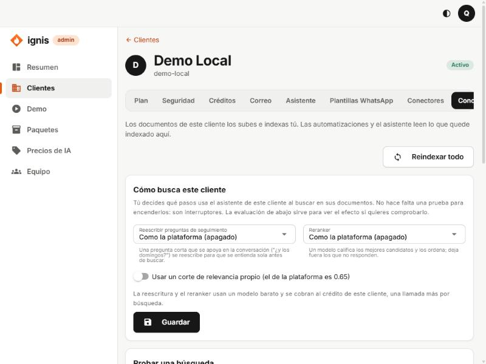
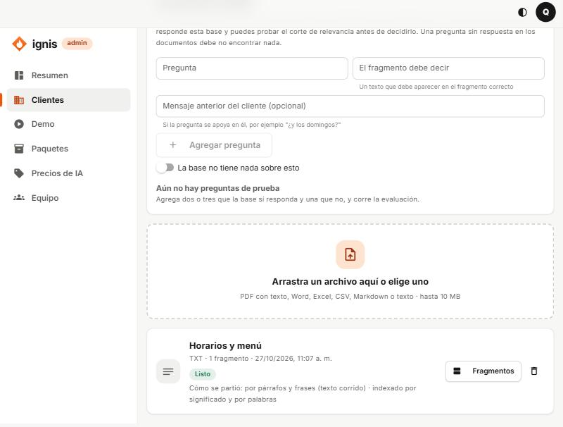

# 9. Pestaña Conocimiento (RAG)

## Para qué sirve

El asistente no inventa los datos del negocio: **los lee de sus documentos**. Esta pestaña es donde **tú, el equipo de Ignis, subes e indexas los documentos del cliente** (menús, precios, políticas, preguntas frecuentes), decides **cómo busca** el asistente y **mides si responde bien**. Las automatizaciones también pueden consultar este conocimiento (paso «Consultar conocimiento»).

> RAG = _retrieval-augmented generation_: antes de responder, el asistente **busca** los fragmentos de documentos que se parecen a la pregunta y se los da a la IA como datos. Si la pregunta no tiene respuesta en los documentos, el asistente debe decirlo con honestidad.

Requisito: módulo **Conocimiento** en [Plan](02-pestana-plan.md). Límites: **Documentos de conocimiento** (50 por defecto) y **Almacenamiento de conocimiento** (100 MiB).

La pestaña tiene cuatro bloques, de arriba hacia abajo.



## Bloque 1: Reindexar todo

**Reindexar todo** (arriba a la derecha) vuelve a procesar **todos** los documentos del cliente. Pide confirmación. Los documentos siguen respondiendo mientras tanto. **Úsalo si cambió el modelo de búsqueda** (el de embeddings) de la plataforma.

## Bloque 2: Cómo busca este cliente

Tú decides qué pasos usa la búsqueda de este cliente. **No hace falta una prueba para encenderlos: son interruptores.**

| Opción                                  | Qué hace                                                                                                                                                       | Valores                                                                                                      |
| --------------------------------------- | -------------------------------------------------------------------------------------------------------------------------------------------------------------- | ------------------------------------------------------------------------------------------------------------ |
| **Reescribir preguntas de seguimiento** | Una pregunta corta que se apoya en la conversación («¿y los domingos?») se reescribe con el mensaje anterior para que se entienda sola antes de buscar.        | **Como la plataforma (apagado/encendido)** · **Encendido para este cliente** · **Apagado para este cliente** |
| **Reranker**                            | Un modelo califica de 0 a 3 los mejores candidatos y los ordena; deja fuera los que no responden.                                                              | Los mismos tres valores.                                                                                     |
| **Usar un corte de relevancia propio**  | La **similitud mínima** (de 0 a 1) que debe tener un fragmento con la pregunta para llegarle al asistente. El de la plataforma es 0,65. **0 deja pasar todo**. | Interruptor + campo **Similitud mínima**.                                                                    |

- La reescritura y el reranker **usan un modelo barato y se cobran al crédito del cliente** (una llamada más por búsqueda). Si la plataforma no tiene proveedor de IA, se muestra «Necesita un proveedor de IA configurado en la plataforma.» y no se pueden encender.
- Pulsa **Guardar** (verás «Guardado.»). «No se pudo guardar. Revisa los valores.» si el corte no está entre 0 y 1.

**Cómo decidir:** apágalos por defecto. Enciéndelos para un cliente cuando la **evaluación** (bloque 4) muestre que mejoran el acierto. El corte se ajusta con las preguntas de prueba.

## Bloque 3: Probar una búsqueda

Escribe una pregunta como la haría un cliente y mira **qué fragmentos encuentra el asistente, en qué orden y por qué**.

| Campo            | Qué es                                                                                                    |
| ---------------- | --------------------------------------------------------------------------------------------------------- |
| **Pregunta**     | El texto a buscar.                                                                                        |
| **Cuántos**      | Cuántos resultados mostrar.                                                                               |
| **Probar corte** | Una similitud mínima (0–1) **solo para esta prueba**, sin cambiar la del cliente. Vacío = la configurada. |
| **Reranker**     | **Como lo tiene el cliente**, **Probar encendido** o **Probar apagado**.                                  |

Cada resultado muestra el documento y sección, el texto, y:

- **Puntaje:** ordena los resultados de esta búsqueda (no se compara con otra).
- **Significado** y **Palabras:** en qué lugar puso ese fragmento cada ranking (— si no lo encontró). La búsqueda combina las dos.
- **Similitud:** cercanía con la pregunta (0–1).
- **Nota del reranker:** de 0 a 3, si se usó.
- Si **llega al asistente** o **se deja fuera** (por no alcanzar el corte).

Mensajes:

- «Corte de relevancia: un fragmento necesita similitud de X o más para llegar al asistente.» / «Sin corte de relevancia…».
- «Esta búsqueda fue solo por palabras…»: el servicio de significado (Ollama) no respondió o los documentos se indexaron con otro modelo; ver [Problemas frecuentes](14-problemas-frecuentes.md).

## Bloque 4: Evaluación de calidad

Sirve para **medir** si la base responde bien **antes** de decidir el corte o encender pasos.

1. En **Agregar pregunta** escribe una **Pregunta** que harían los clientes y en **El fragmento debe decir** un texto que debe aparecer en el fragmento correcto (por ejemplo `lunes a sábado`).
2. Opcional: **Mensaje anterior del cliente** si la pregunta se apoya en él.
3. Para una pregunta que **no** debe tener respuesta, enciende **La base no tiene nada sobre esto**: pasa si no se encuentra ningún fragmento.
4. Agrega **dos o tres que la base sí responda y una que no** (hasta 100 por cliente).
5. Pulsa **Correr evaluación** (puedes elegir **Cuántos fragmentos**, **Probar corte** y probar el reranker o la reescritura encendidos/apagados).

Resultados:

| Métrica               | Qué significa                                                                 |
| --------------------- | ----------------------------------------------------------------------------- |
| **Pasaron**           | Cuántas preguntas pasaron sobre el total.                                     |
| **Acierto**           | De las preguntas con respuesta, cuántas encontraron el fragmento correcto.    |
| **Posición (MRR)**    | 1 si el fragmento correcto es siempre el primero; baja cuanto más abajo sale. |
| **Silencio correcto** | De las preguntas sin respuesta, cuántas no encontraron nada.                  |

Cada pregunta dice «Salió en el lugar N» o «No salió», cuántos fragmentos llegarían al asistente y la mejor similitud.

## Bloque 5: los documentos



### Subir un documento

1. Arrastra un archivo al recuadro punteado o pulsa para elegirlo.
2. **Tipos:** PDF **con texto** (no escaneado), Word, Excel, CSV, Markdown o texto. **Hasta 10 MB.**
3. Verás «Documento recibido. Se está indexando.». El estado pasa de **Indexando** a **Listo**.

Errores: «El archivo pesa más de 10 MB.» · «Ese tipo de archivo no se puede leer. Usa PDF, Word, Excel, CSV, Markdown o texto.» · límite de documentos alcanzado.

### Cada documento

Muestra el título, el tipo, cuántos **fragmentos** tiene, su estado y **cómo se partió**:

| Cómo se partió                                        | Cuándo                           |
| ----------------------------------------------------- | -------------------------------- |
| por párrafos y frases (texto corrido)                 | Texto plano, PDF sin estructura. |
| por títulos, con la ruta de títulos en cada fragmento | Markdown (y Word con títulos).   |
| por grupos de filas de cada hoja                      | Excel y CSV.                     |
| por página                                            | Documentos paginados.            |

Y si se indexó **por significado y por palabras** o **solo por palabras** («Solo búsqueda por palabras» cuando el servicio de significado no estaba disponible).

Botones por documento:

- **Fragmentos:** muestra cómo quedó partido; cada fragmento es lo que el asistente puede encontrar y leer, con sus caracteres y si se indexó por significado y palabras. **Ver completo / Ver menos**.
- **Reintentar / Reindexar:** vuelve a procesarlo (si falló o cambió el modelo).
- **Borrar** (papelera): el asistente deja de usarlo; no se puede deshacer.
- «N imágenes sin leer»: el documento tenía imágenes; **no se leen** (no hay OCR todavía).

---

# Tutorial: preparar el conocimiento de «Café Luna»

1. **Redacta el documento.** Un archivo de texto o Markdown con datos concretos y títulos claros. Ejemplo (`cafe-luna.md`):

   ```markdown
   # Horarios

   Abrimos de lunes a sábado de 8:00 a 18:00. Los domingos cerramos.

   # Menú del día

   Sándwich de pollo con jugo natural: 18.000 pesos.

   # Domicilios

   Sin costo dentro de Medellín en pedidos de más de 30.000 pesos.
   ```

   Consejos: una idea por párrafo; incluye las palabras que usan los clientes («domicilio», «horario», «a qué hora»); evita tablas escaneadas o PDF de imágenes.

2. **Súbelo** en el recuadro punteado. Espera a **Listo**.
3. Pulsa **Fragmentos** y confirma que quedó partido por los títulos.
4. **Prueba una búsqueda:** pregunta `¿a qué hora abren los domingos?` y comprueba que el fragmento de **Horarios** llega al asistente.
5. **Evaluación:** agrega
   - `¿Hasta qué hora atienden?` → debe decir `18:00`
   - `¿Cuánto cuesta el domicilio?` → debe decir `30.000`
   - `¿Venden pizza?` → **La base no tiene nada sobre esto** (activado)
6. **Correr evaluación.** Si las tres pasan, el conocimiento está listo. Si la de pizza trae fragmentos, sube la **Similitud mínima** (por ejemplo a 0,70) en **Cómo busca este cliente** y vuelve a correr.
7. Para ver el efecto real, usa **Demo** o una conversación del cliente.

## Errores frecuentes

- **El documento se queda en «Indexando» o dice «Falló»:** revisa que el worker esté corriendo; usa **Reintentar**.
- **El asistente no encuentra algo que sí está:** mira **Fragmentos** (¿se partió bien?), baja el corte, o reescribe el documento con las palabras del cliente.
- **El asistente «inventa»:** sube el corte de relevancia y verifica que la pregunta sin respuesta de la evaluación **no** encuentre nada.
