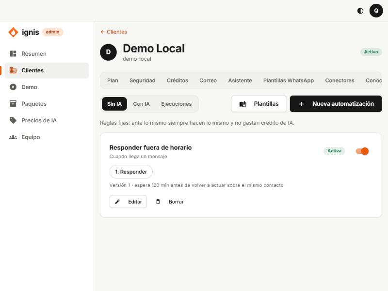
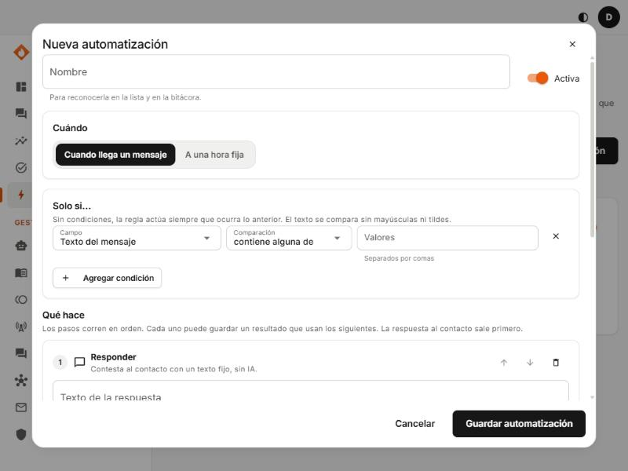
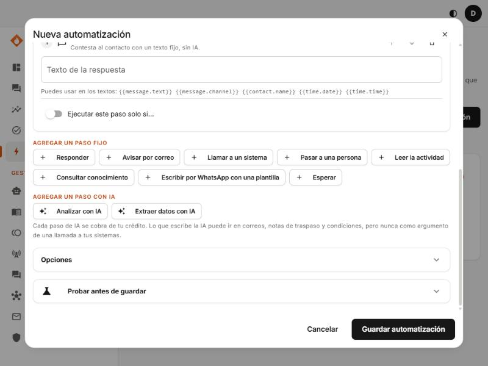
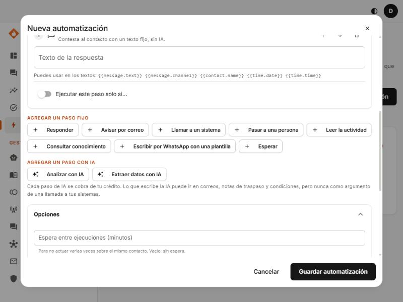

# 10. Pestaña Automatizaciones

## Para qué sirve

Una **automatización** es una **regla fija**: «**cuando** pasa algo, **y si** se cumplen unas condiciones, **entonces** haz esto». Es distinta del asistente: **ante lo mismo siempre hace lo mismo**, así que es predecible y, si no usa IA, **no gasta crédito**. Sirve para lo que no quieres dejar a la improvisación: responder el horario fuera de hora, avisar por correo de una queja, pasar a una persona, mandar un resumen cada mañana, escribir por WhatsApp con una plantilla, llamar a un sistema del negocio.

Las puedes crear tú aquí (**Automatizaciones** de la ficha del cliente) o el dueño en su propio panel (**Automatizaciones**): es la misma pantalla.



> Requisitos en [Plan](02-pestana-plan.md): módulo **Automatizaciones** (sin IA) y, para los pasos de IA, **Automatizaciones con IA**. Límites: **Reglas de automatización** (20) y **Ejecuciones por día** (500).

## La pantalla principal

Arriba, tres pestañas:

| Pestaña         | Qué muestra                                                                                                                                              |
| --------------- | -------------------------------------------------------------------------------------------------------------------------------------------------------- |
| **Sin IA**      | Reglas fijas: ante lo mismo siempre hacen lo mismo y no gastan crédito de IA.                                                                            |
| **Con IA**      | Flujos con pasos de IA: un modelo clasifica o resume y las condiciones que escribes deciden el camino. Cada paso de IA se cobra del crédito del cliente. |
| **Ejecuciones** | La bitácora: lo que hizo cada automatización, paso por paso (se guarda 30 días).                                                                         |

Dos botones: **Plantillas** (arrancar desde una lista de reglas listas) y **Nueva automatización**.

Cada tarjeta de regla muestra: nombre, **cuándo actúa**, el interruptor **Activa/Apagada**, los pasos como etiquetas numeradas, «Versión N», la espera por contacto («espera 120 min antes de volver a actuar sobre el mismo contacto») y, si usa IA, el tope de gasto. Botones **Editar** y **Borrar** (borrar es inmediato: deja de actuar; sus ejecuciones pasadas quedan en la bitácora hasta que vencen).

## Empezar desde una plantilla


**Plantillas** abre una galería con filtros **Todas / Atender clientes / Avisos / Reportes**. Cada tarjeta dice qué hace, **cuándo actúa**, y qué necesita: **Necesita el correo del negocio** (si avisa por correo), **Usa IA y se cobra de tu crédito** o **Sin IA: no gasta crédito**.

| Plantilla                                             | Qué hace                                                                         |
| ----------------------------------------------------- | -------------------------------------------------------------------------------- |
| **Responder fuera de horario**                        | Quien escribe antes de abrir o después de cerrar recibe un aviso con el horario. |
| **Dar la bienvenida a quien escribe por primera vez** | Saludo a contactos nuevos.                                                       |
| **Contestar una pregunta frecuente**                  | Si el mensaje trae ciertas palabras, responde siempre lo mismo.                  |
| **Pasar a una persona cuando hay una queja**          | Responde y pasa la conversación a una persona.                                   |
| **Avisarme por correo cuando algo es urgente**        | Correo con el texto y quién lo escribió.                                         |
| **Resumen diario de actividad**                       | Cada día, por correo, las cifras de ayer.                                        |
| **Análisis semanal con IA**                           | Cada lunes una IA compara la semana con la anterior y la envía por correo.       |
| **Detectar con IA los mensajes urgentes**             | Una IA lee cada mensaje y, si es urgente, lo pasa a una persona.                 |

Pasos: **Usar esta plantilla** → responde **Unas preguntas** (ya vienen con un valor de ejemplo) → **Armar la automatización** → la ves armada en el constructor, **la cambias si quieres** y **Guardar automatización**.


## El constructor, sección por sección



### Nombre y Activa

- **Nombre:** para reconocerla en la lista y en la bitácora (hasta 80 caracteres).
- **Activa:** si está apagada, no actúa.

### Cuándo

- **Cuando llega un mensaje:** actúa con cada mensaje de un contacto.
- **A una hora fija:** actúa a una hora del día.
  - **Hora:** `HH:MM`.
  - **Zona horaria:** por ejemplo `America/Bogota`.
  - **Días:** lun…dom; **sin marcar ninguno, corre todos los días.**

> Las reglas por **hora fija** no tienen un contacto: no pueden **Responder** ni **Pasar a una persona** (las dos solo existen cuando llega un mensaje).

### Solo si… (condiciones)

Sin condiciones, la regla actúa siempre que ocurra lo anterior. **El texto se compara sin mayúsculas ni tildes.**

- **Se cumplen todas / Se cumple alguna:** cómo se combinan.
- Cada condición es **Campo + Comparación + Valor**:

| Campo                        | Qué es                                  |
| ---------------------------- | --------------------------------------- |
| **Texto del mensaje**        | Lo que escribió el contacto.            |
| **Canal del mensaje**        | `whatsapp`, `instagram`, `facebook`.    |
| **Nombre del contacto**      | Su nombre en el canal.                  |
| **Canal del contacto**       | El canal del contacto.                  |
| **Es un contacto nuevo**     | Sí / No.                                |
| **Día de la semana (1 a 7)** | 1 = lunes … 7 = domingo.                |
| **Hora (0 a 23)**            | La hora en la zona horaria de la regla. |
| **Fecha (AAAA-MM-DD)**       |                                         |

(En reglas por hora fija solo están los campos de día y hora.)

| Comparación                                                                   | Significa                                                      |
| ----------------------------------------------------------------------------- | -------------------------------------------------------------- |
| **es igual a** / **es distinto de**                                           | Igualdad exacta (texto sin mayúsculas/tildes, número o Sí/No). |
| **contiene**                                                                  | El texto incluye lo escrito.                                   |
| **contiene alguna de**                                                        | Incluye **alguna** de varias palabras (separadas por comas).   |
| **empieza con**                                                               |                                                                |
| **es uno de**                                                                 | Es igual a **alguno** de varios valores.                       |
| **es mayor que / es mayor o igual que / es menor que / es menor o igual que** | Para números (hora, día).                                      |
| **tiene valor**                                                               | El campo existe.                                               |

Hasta **10 condiciones**.

### Qué hace (los pasos)



«Los pasos corren en orden. Cada uno puede guardar un resultado que usan los siguientes. La respuesta al contacto sale primero.» Hasta **10 pasos**. Cada paso tiene flechas para **subir/bajar** y un cubo para **quitarlo**.

En los textos de los pasos puedes usar **campos** entre llaves dobles, y la pantalla te lista los que están disponibles: `{{message.text}}`, `{{message.channel}}`, `{{contact.name}}`, `{{time.date}}`, `{{time.time}}` y los resultados de pasos anteriores (`{{vars.nombre}}`).

#### Condición de un paso: «Ejecutar este paso solo si…»

Cada paso puede llevar su propia condición, que **sí** puede mirar lo que dejaron los pasos anteriores (por ejemplo, la urgencia que devolvió la IA). La **respuesta** es la excepción: sale antes que los demás pasos, así que solo puede mirar el mensaje y la hora.

#### Pasos fijos (no usan IA)

| Paso                                        | Qué hace                                                                                                                                           | Campos                                                                                                                                                                                                                                                                                                                                                                            |
| ------------------------------------------- | -------------------------------------------------------------------------------------------------------------------------------------------------- | --------------------------------------------------------------------------------------------------------------------------------------------------------------------------------------------------------------------------------------------------------------------------------------------------------------------------------------------------------------------------------- |
| **Responder**                               | Contesta al contacto con un **texto fijo**, sin IA. Sale **antes** que los demás pasos. Solo una respuesta por regla. Solo con «llega un mensaje». | **Texto de la respuesta** (hasta 1000).                                                                                                                                                                                                                                                                                                                                           |
| **Avisar por correo**                       | Escribe a las direcciones de aviso del cliente (pestaña **Correo**).                                                                               | **Asunto** (150) y **Mensaje** (4000).                                                                                                                                                                                                                                                                                                                                            |
| **Llamar a un sistema**                     | Llama a una operación de un [conector](08-pestana-conectores.md).                                                                                  | **Sistema**, **Operación**, **Argumentos** (cada uno admite campos) y **Guardar el resultado como** (opcional) → `{{vars.nombre}}`. Si es una operación de escritura se ejecuta sin pedir confirmación cada vez, porque tú diseñaste la regla.                                                                                                                                    |
| **Pasar a una persona**                     | Detiene al asistente y avisa al equipo. Solo uno por regla; solo con «llega un mensaje».                                                           | **Nota para el equipo** (opcional, 300); vacía = nombre de la regla.                                                                                                                                                                                                                                                                                                              |
| **Leer la actividad**                       | Trae las cifras del negocio.                                                                                                                       | **Periodo** (últimos 1 a 90 días, sin contar hoy) y **Guardar como** (obligatorio). Deja `messages_in`, `messages_out`, `conversations_active`, `new_contacts`, `handoffs`, `llm_calls`, `charged_micro`, `from`, `to`, `days` y el periodo anterior en `previous.*` (ej. `{{vars.stats.previous.messages_in}}`).                                                                 |
| **Consultar conocimiento**                  | Busca en los documentos del cliente.                                                                                                               | **Qué buscar** (500, admite campos; los datos personales no se envían), **Guardar como**, **Cuántos fragmentos** (1 a 8; vacío = 4). Deja `{{vars.nombre.text}}` (lo encontrado), `vars.nombre.found` (sí/no) y las fuentes.                                                                                                                                                      |
| **Escribir por WhatsApp con una plantilla** | Envía un mensaje **aprobado por Meta**, aunque el contacto lleve más de 24 horas sin escribir.                                                     | **Plantilla** (puede estar en revisión al guardar, pero debe estar **aprobada** cuando corre); **Número (opcional)**: vacío = al contacto del mensaje; con número (solo dígitos y código de país), a ese número (ej. para avisarte a ti). **En una regla por hora fija el número es obligatorio.** **Variable 1, 2…**: el valor de cada variable de la plantilla (admite campos). |
| **Esperar**                                 | Pausa la regla y luego sigue con el paso siguiente.                                                                                                | **Cuánto** + **Unidad** (minutos/horas/días): de **1 minuto a 7 días**. Máximo **2 esperas** por regla y **no puede ser el último paso**.                                                                                                                                                                                                                                         |

Detalles de **Esperar:** mientras espera, la ejecución aparece **Esperando** con la fecha en que sigue. Si apagas o borras la regla durante la espera, la ejecución queda **Omitida**.

#### Pasos con IA (se cobran del crédito)


«Cada paso de IA se cobra de tu crédito. Lo que escribe la IA puede ir en correos, notas de traspaso y condiciones, pero **nunca como argumento de una llamada a tus sistemas**.» (Es una protección: un texto «inyectado» no puede convertirse en un cambio en el CRM.)

| Paso                     | Qué hace                                                              | Campos                                                                                                                                                                                                                                                                                                                 |
| ------------------------ | --------------------------------------------------------------------- | ---------------------------------------------------------------------------------------------------------------------------------------------------------------------------------------------------------------------------------------------------------------------------------------------------------------------- |
| **Analizar con IA**      | Un modelo **escribe** un resumen o análisis de los datos.             | **Instrucción para la IA** (hasta 1500; se escribe **una vez y sin `{{campos}}`**), **Datos que lee la IA** (hasta 8; cada uno con **Nombre del dato** y **Contenido** que admite campos), **Modelo** (proveedor y modelo; «El del plan» por defecto), **Largo máximo de la respuesta** (50 a 1500), **Guardar como**. |
| **Extraer datos con IA** | Un modelo **devuelve datos en una forma fija**, como urgencia y tema. | Lo mismo, más **Qué debe devolver**: un campo por dato (hasta 12) con **Campo**, **Tipo** (Texto, Número, Entero, Sí o no), **Valores permitidos** (opcional, separados por comas; la IA solo puede elegir entre ellos, solo para Texto) y **Obligatorio**. Se usa como `{{vars.nombre.campo}}`.                       |

Los **datos personales** (correos, teléfonos, nombres) **se ocultan** antes de enviarlos a la IA, y la IA los lee **como información, nunca como órdenes**.

### Opciones



| Opción                                      | Qué hace                                                                                       |
| ------------------------------------------- | ---------------------------------------------------------------------------------------------- |
| **Espera entre ejecuciones (minutos)**      | Para no actuar varias veces sobre el **mismo contacto**. De 0 a 1440; vacío = sin espera.      |
| **Zona horaria de la hora y el día**        | La zona con la que se leen «hora» y «día de la semana» en las condiciones (reglas de mensaje). |
| **Tope de gasto de IA por ejecución (USD)** | Hasta 0,50; vacío = 0,10. Si una ejecución llega al tope, se detiene.                          |

### Probar antes de guardar

Simula un evento y muestra **qué haría la regla**. **No envía nada, no llama a tus sistemas y no gasta IA.**

| Campo                                                        | Qué es                                           |
| ------------------------------------------------------------ | ------------------------------------------------ |
| **Mensaje de ejemplo**                                       | El texto que «escribió» el contacto.             |
| **Nombre del contacto**, **Canal**, **Es un contacto nuevo** | Datos del contacto de la prueba.                 |
| **Momento (opcional)**                                       | Por defecto, ahora (sirve para probar horarios). |

Pulsa **Probar**: dice «La regla actuaría» o «La regla no actuaría», cómo salió cada condición y, si actúa, **Haría esto** con los textos ya rellenados. Siempre termina con «No se envió nada.».

### Guardar

**Guardar automatización.** Si algo está mal, el mensaje dice **qué** y **dónde**: por ejemplo «No se pudo guardar: acción 2: la plantilla pedido_listo lleva 2 valores y se dieron 1».

## La bitácora: Ejecuciones

Cada vez que una regla actúa se registra una **ejecución** con sus pasos. Se guarda **30 días** y **nunca incluye lo que escribió el contacto**.

| Estado        | Significa                                          |
| ------------- | -------------------------------------------------- |
| **En curso**  | Está corriendo.                                    |
| **Esperando** | Está en un paso **Esperar**; muestra «sigue el …». |
| **Terminada** | Todos los pasos salieron bien.                     |
| **Falló**     | Un paso falló; se muestra cuál y por qué.          |
| **Omitida**   | Se apagó o borró la regla antes de correr.         |

Pulsa una ejecución para ver sus pasos (con ✓ o ✗, el detalle y, si usó IA, el costo). En una ejecución que **Falló**, el botón **Reintentar** la **retoma desde el paso que falló**: «lo que ya salió bien no se repite». No se puede reintentar si la regla está apagada o borrada.

---

# Tutoriales paso a paso

## Tutorial A: «Responder fuera de horario» desde una plantilla (2 minutos)

1. **Plantillas** → en **Responder fuera de horario** pulsa **Usar esta plantilla**.
2. Responde: **Hora de apertura** `8`, **Hora de cierre** `18`, **Mensaje** `¡Hola! Ahora estamos cerrados. Atendemos de lunes a sábado de 8:00 a 18:00 y te respondemos apenas abramos.`
3. **Armar la automatización.** Verás: _Cuándo:_ llega un mensaje · _Solo si… se cumple alguna:_ hora es menor que 8, hora es mayor o igual que 18 · _Qué hace:_ Responder.
4. Revisa; si el negocio abre los domingos, esta plantilla no lo sabe (responde a cualquier hora fuera de 8–18). Puedes agregar una condición o dejarlo así.
5. **Probar antes de guardar:** escribe `hola`, pon **Momento** a las 20:00 y pulsa **Probar** → «La regla actuaría». Prueba a las 10:00 → «No actuaría».
6. **Guardar automatización.**

## Tutorial B: avisar por correo y pasar a una persona cuando hay una queja (desde cero)

Objetivo: si alguien escribe «queja», «reclamo» o «molesto», el asistente le responde, la conversación pasa a una persona y llega un correo al dueño.

1. **Nueva automatización**. **Nombre:** `Queja: avisar y pasar a una persona`.
2. **Cuándo:** deja **Cuando llega un mensaje**.
3. **Solo si…:** **Campo** `Texto del mensaje` · **Comparación** `contiene alguna de` · **Valores** `queja, reclamo, molesto, mal servicio`.
4. **Qué hace:** el constructor trae un paso **Responder**. Escribe: `Entiendo, {{contact.name}}. Ya le aviso a una persona de nuestro equipo para que te atienda.`
5. Agrega **Pasar a una persona** (botón **+ Pasar a una persona**). **Nota para el equipo:** `El cliente presentó una queja`.
6. Agrega **Avisar por correo**. **Asunto:** `Queja de {{contact.name}}` · **Mensaje:** `{{contact.name}} escribió por {{message.channel}}: {{message.text}}`. (Necesita el módulo Correo y las direcciones de aviso del cliente.)
7. **Opciones:** **Espera entre ejecuciones (minutos)** `60`, para no repetir el aviso si el cliente insiste.
8. **Probar antes de guardar:** mensaje `tengo una queja del pedido` → debe mostrar «La regla actuaría» y los tres pasos. Con `hola` → «no actuaría».
9. **Guardar automatización.**

## Tutorial C: detectar mensajes urgentes con IA

Objetivo: una IA lee cada mensaje y, si lo ve urgente, lo pasa a una persona.

1. **Nueva automatización** → **Nombre:** `Detectar urgencia con IA`. **Cuándo:** llega un mensaje. Sin condiciones.
2. Quita el paso **Responder** que trae (cubo) y agrega **Extraer datos con IA** (en «Agregar un paso con IA»).
3. **Instrucción para la IA:** `Decide si el mensaje del cliente es urgente o muestra mucho enojo. Responde solo con los datos pedidos.`
4. **Datos que lee la IA** → **Agregar un dato:** **Nombre** `Mensaje` · **Contenido** `{{message.text}}`.
5. **Qué debe devolver** → **Agregar un campo:** **Campo** `urgent` · **Tipo** `Sí o no` · **Obligatorio** activado.
6. **Guardar el resultado como:** `triage`.
7. Agrega **Pasar a una persona**; **Nota:** `La IA vio el mensaje como urgente`. Abre **Ejecutar este paso solo si…** y configura: **Campo** `vars.triage.urgent` · **Comparación** `es igual a` · **Valor** `true`.
8. **Opciones:** **Espera entre ejecuciones** `30` y **Tope de gasto de IA** `0,02`.
9. **Guardar.** Cada mensaje cuesta una llamada de IA pequeña, que se cobra del crédito del cliente.

## Tutorial D: resumen diario por correo (hora fija)

1. **Nueva automatización** → **Nombre:** `Resumen diario`.
2. **Cuándo:** **A una hora fija** → **Hora** `07:00` · **Zona horaria** `America/Bogota` · **Días:** ninguno marcado (todos los días).
3. Quita el paso **Responder** (no existe en reglas por hora).
4. Agrega **Leer la actividad** → **Periodo** `Últimos 1 días` · **Guardar como** `stats`.
5. Agrega **Avisar por correo**:
   - **Asunto:** `Resumen de ayer ({{vars.stats.from}})`
   - **Mensaje:**
     ```
     Mensajes recibidos: {{vars.stats.messages_in}}
     Mensajes enviados: {{vars.stats.messages_out}}
     Contactos nuevos: {{vars.stats.new_contacts}}
     Pasadas a una persona: {{vars.stats.handoffs}}
     ```
6. **Guardar.** Mañana a las 7:00 (hora de Bogotá) llegará el correo. Verás la ejecución en **Ejecuciones**.

## Tutorial E: seguimiento 24 horas después con una plantilla de WhatsApp

Objetivo: cuando alguien escribe «pedido», espera un día y le escribe con una plantilla aprobada (fuera de la ventana de 24 horas).

1. Antes: crea y consigue **Aprobada** la plantilla `pedido_listo` (ver [Plantillas WhatsApp](07-pestana-plantillas-whatsapp.md)).
2. **Nueva automatización** → **Nombre:** `Seguimiento de pedido`. **Solo si:** `Texto del mensaje` `contiene` `pedido`.
3. Quita **Responder**. Agrega **Esperar** → **Cuánto** `1` · **Unidad** `días`.
4. Agrega **Escribir por WhatsApp con una plantilla** → **Plantilla** `pedido_listo (es)` · **Número** vacío (le escribe al contacto) · **Variable 1** `{{contact.name}}` · **Variable 2** el texto que corresponda.
5. **Guardar.** Cada mensaje con «pedido» crea una ejecución que queda **Esperando** hasta mañana.

## Errores frecuentes

- «Tu plan no incluye las automatizaciones» / «…con IA»: activa el módulo en **Plan**.
- «Llegaste al límite de automatizaciones de tu plan»: sube **Reglas de automatización**.
- «Una espera necesita un paso después» / «Una automatización espera como máximo 2 veces.»
- «Una regla programada no tiene contacto al que escribirle: indica el número.»
- «Una condición del paso usa un resultado que no existe antes de ese paso»: el paso que guarda `vars.x` debe estar **antes**.
- «Lo que escribe una IA no puede ser argumento de una llamada a tus sistemas.»
- Una ejecución **Falló** con «la plantilla … no está aprobada por Meta»: espera su aprobación y usa **Reintentar**.
- Una ejecución **Falló** con «el correo del negocio aún no está configurado»: configura la pestaña **Correo**.
