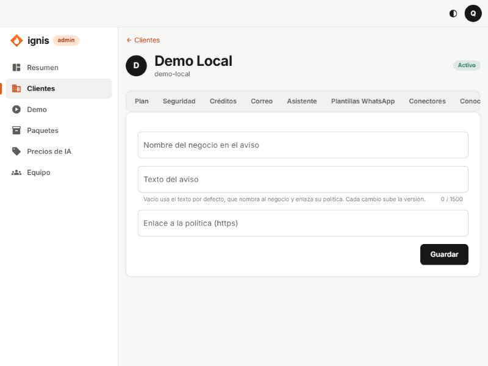

# 11. Pestaña Privacidad

## Para qué sirve

Las personas que escriben al negocio tienen derecho a saber **cómo se tratan sus datos**. Esta pestaña define el **aviso de privacidad** que el asistente muestra a un contacto la **primera vez** que escribe. Cada cambio del aviso **sube su versión**, y cada consentimiento queda registrado con la versión que el contacto vio.

Requisito: módulo **Privacidad** en [Plan](02-pestana-plan.md).

## Las opciones

| Campo                              | Qué es                                                                                             | Reglas                                                               |
| ---------------------------------- | -------------------------------------------------------------------------------------------------- | -------------------------------------------------------------------- |
| **Nombre del negocio en el aviso** | Cómo se nombra al negocio en el texto por defecto.                                                 | Texto corto.                                                         |
| **Texto del aviso**                | El aviso completo. **Vacío usa el texto por defecto**, que nombra al negocio y enlaza su política. | Hasta **1500** caracteres (hay contador).                            |
| **Enlace a la política (https)**   | Dirección de la política de privacidad completa del negocio.                                       | Debe empezar por `https://` («El enlace debe empezar por https://»). |

Al guardar verás «Aviso guardado.». Debajo, **Así lo ven los contactos** muestra la vista previa.

## Cómo funciona el consentimiento

1. El contacto escribe por primera vez y el asistente le muestra el aviso. Quedan registrados el consentimiento (**Avisado**) y la versión.
2. Si **sigue escribiendo**, se entiende que lo acepta (**Aceptó**, origen «Siguió la conversación»).
3. Si responde **NO ACEPTO**, deja de ser atendido por el asistente y queda **Revocó**.
4. Para **correos** al contacto (módulo Correo) se exige un **sí explícito** a recibirlos.

## Lo que el dueño ve y puede hacer

En su panel, **Privacidad** tiene tres pestañas: **Aviso** (el texto vigente y su versión), **Contactos** (qué aceptó cada uno; exportar sus datos, registrar un consentimiento, o **Borrar contacto**) y **Borrados** (la prueba de consentimiento que se conserva sin datos personales). Ver [la guía del cliente](../cliente/13-privacidad.md).

## Retención

El límite **Días de retención de contactos** (365 por defecto) en [Plan](02-pestana-plan.md) borra automáticamente a los contactos sin actividad pasado ese tiempo (`-1` = no borrar nunca).

## Aviso importante

El texto por defecto es una base razonable, **no asesoría legal**. Antes de operar con clientes reales, haz que un abogado revise el aviso y la política enlazada según las normas de protección de datos del país del negocio.
