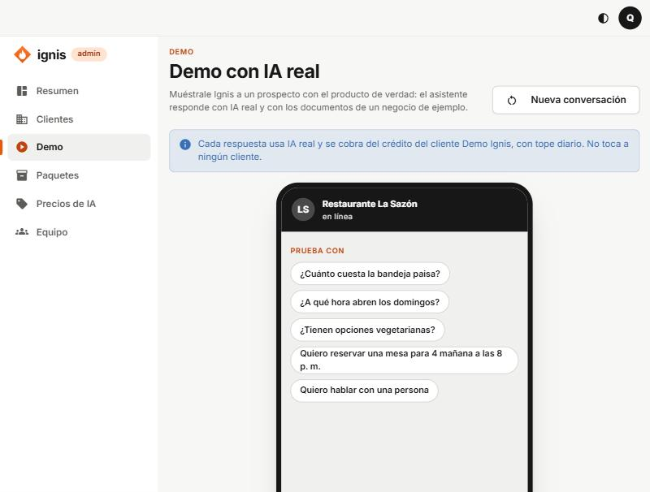
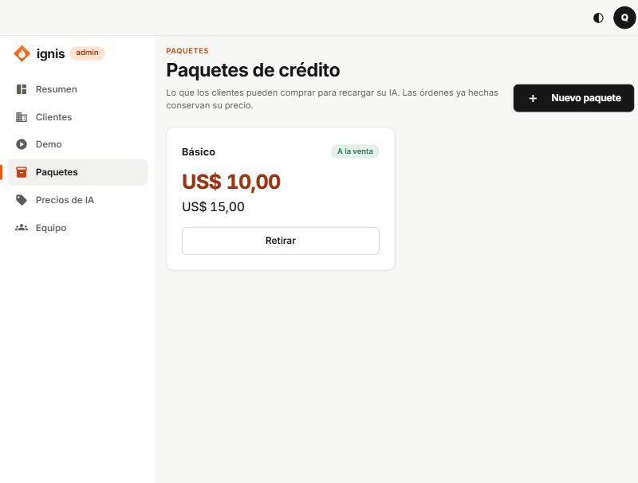
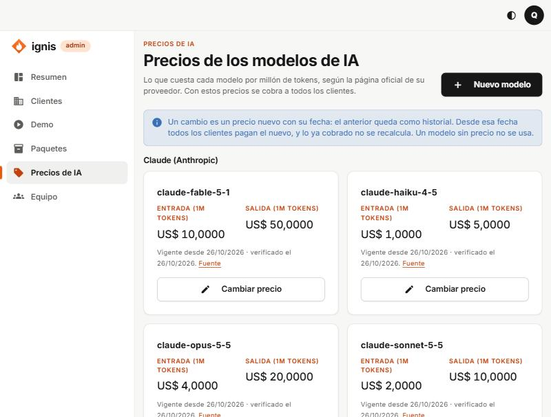
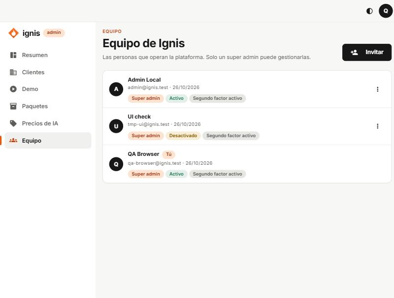

# 12. Apartados generales del panel de Ignis

Además de la ficha de cada cliente, el menú del panel de Ignis tiene cinco apartados que afectan a toda la plataforma.

## Resumen

«Cómo va la plataforma: lo que se cobra, lo que cuesta y la salud de la cola.»

| Cifra                           | Qué es                                                                                                       |
| ------------------------------- | ------------------------------------------------------------------------------------------------------------ |
| **Clientes**                    | Cuántos negocios hay.                                                                                        |
| **Cobrado por IA**              | Lo que se ha cobrado a los clientes por usar IA en el periodo.                                               |
| **Costo del proveedor**         | Lo que Ignis pagó a los proveedores de IA por ese mismo uso.                                                 |
| **Margen**                      | Cobrado menos costo.                                                                                         |
| **Crédito comprado sin gastar** | «Lo que Ignis debe en IA a sus clientes»: crédito vendido que aún no se consumió.                            |
| **Cobrado por cliente**         | Reparto del cobro entre los clientes. «Todavía no hay consumo en este periodo» si no hay datos.              |
| **Cola de trabajos**            | Trabajos **En espera**, **En curso**, **Hechos** y **Muertos**; el más viejo que espera y los **Atascados**. |

Si ves «Hay trabajos muertos o atascados: revísalos.», el worker no está corriendo o algo falla de forma repetida (ver [Problemas frecuentes](14-problemas-frecuentes.md)).

## Demo

Para enseñarle Ignis a un prospecto con el producto real: el asistente responde con **IA real** y con los documentos de un restaurante de ejemplo («Restaurante La Sazón»).

1. **Preparar demo** crea (o repara, sin riesgo de repetirlo) el cliente **Demo Ignis** con menú, horarios y reservas en su conocimiento, crédito para el mes y un tope diario.
2. Escribe en la caja «como el cliente del negocio» o usa las sugerencias de **Prueba con**. **Nueva conversación** empieza de cero.
3. A la derecha, **Por dentro** muestra lo que Ignis hace detrás: el estado del asistente, si **pasó la conversación a una persona** (con **Devolver al asistente**), las **acciones por aprobar** (**Aprobar** / **Rechazar**), el conocimiento del negocio, el **crédito del demo** y su **tope diario**.

Cada respuesta se cobra del crédito de Demo Ignis; no toca a ningún cliente real. Si tarda demasiado: revisa que el worker corra y que haya una clave de IA.

## Paquetes

Lo que los clientes pueden **comprar para recargar su IA**. Las órdenes ya hechas conservan el precio que tenían.

| Campo                   | Qué es                            |
| ----------------------- | --------------------------------- |
| **Nombre**              | Cómo se llama el paquete.         |
| **Crédito de IA (USD)** | Cuánto crédito recibe el cliente. |
| **Precio**              | Cuánto paga.                      |
| **Moneda**              | La del precio.                    |

Cada tarjeta resume «El cliente paga … y recibe … de crédito». **Retirar** saca el paquete de la venta (**Retirado**) y **Poner a la venta** lo devuelve (**A la venta**). Primero crea al menos uno, o los clientes no podrán recargar.

## Precios de IA {#precios-de-ia}

Lo que cuesta cada modelo por **millón de tokens**, según la página oficial del proveedor. **Con estos precios se cobra a todos los clientes.** Un modelo **sin precio vigente no se usa**.

- **Cargar precios oficiales:** carga la lista inicial. **Se hace una sola vez**; después se cambia precio por precio.
- **Nuevo modelo:** **Proveedor**, **Modelo** (el nombre exacto de la API del proveedor), **Entrada** y **Salida** en USD por 1M de tokens (ej. `0,30` o `2,5`), **Desde ahora / Desde una fecha**, **Página oficial del precio** (https) y **Verificado el** (no puede ser futura).
- **Cambiar precio:** se guarda como un precio **nuevo con su fecha**; el anterior queda como historial. Desde esa fecha todos pagan el nuevo; lo ya cobrado **no se recalcula**.

Si ves «Quizá ya existe un precio de ese modelo en esa misma fecha», cambia la fecha de inicio.

## Equipo de Ignis {#equipo}

Las personas que operan la plataforma. **Solo un super admin** ve esta sección.

- **Invitar:** **Correo**, **Nombre**, **Rol**. La persona recibe un enlace de **un solo uso (3 días)** para crear su contraseña y configura su segundo factor al ingresar.
- Cada persona muestra su estado (**Activo/Desactivado**) y si tiene **segundo factor activo**. A ti te marca **Tú**.
- **Desactivar:** sus sesiones terminan al instante y no puede ingresar hasta que la actives.
- **Quitar segundo factor:** úsalo si perdió su teléfono; se borran su segundo factor y sus códigos de recuperación y lo configura de nuevo al ingresar.

## Planes {#planes}

Lo que vende Ignis. Cada plan junta **módulos**, **límites**, el **crédito de IA que incluye cada mes** y su **precio mensual**. Traen tres de ejemplo (**Sin IA**, **Con IA**, **Premium**) y puedes cambiarles **cualquier cosa** o crear otros, incluidos planes **A la medida** para un cliente con su propio precio.

| Campo                                  | Qué es                                                                                                                                                                                |
| -------------------------------------- | ------------------------------------------------------------------------------------------------------------------------------------------------------------------------------------- |
| **Nombre del plan**, **Identificador** | El nombre visible y un código fijo (minúsculas, números y guiones; no cambia después).                                                                                                |
| **Qué incluye**                        | Descripción para el equipo.                                                                                                                                                           |
| **Tipo**                               | **Estándar** o **A la medida**.                                                                                                                                                       |
| **Precio mensual** y **Moneda**        | Informativo: aún no se cobra la suscripción en línea.                                                                                                                                 |
| **Crédito de IA al mes**               | Se entrega cada mes, **vence con el mes y no se acumula**. 0 = el plan no incluye IA. El crédito que el cliente compre aparte dura hasta 6 meses y se gasta **después** del del plan. |
| **Módulos** y **Límites**              | Lo que el cliente puede usar y hasta dónde.                                                                                                                                           |
| **A la venta**                         | Un plan retirado no se puede asignar a nadie nuevo; quienes lo tienen lo conservan.                                                                                                   |

- **Editar un plan** llega a **todos** sus clientes; lo que cada uno tenga ajustado aparte se conserva. Si el plan sube el crédito de IA, se da lo que falta del mes en curso; nunca se quita crédito.
- **Asignar un plan** a un cliente: al crearlo (selector **Plan**) o en su pestaña [Plan](02-pestana-plan.md), tarjeta **Plan del cliente**. Recibe los módulos y límites del plan y se borran sus ajustes.
- Lo que cambies a mano en esa pestaña queda como **ajuste** de ese cliente (se muestra como «Este cliente se aparta del plan»).
